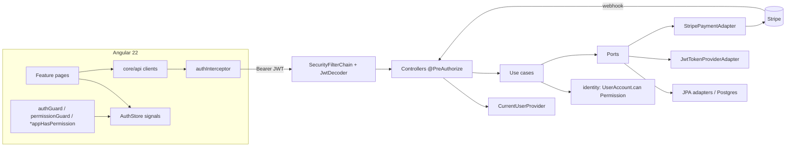

# Requirements

### Overview & Goals
Turn Readora from two disconnected halves into one working product:
- The Angular 22 frontend gets a typed API layer for **every** backend endpoint (existing + new) and its features (`ChapterViewer`, `CommentTree`, `KanbanBoard`) become API-driven instead of in-memory only.
- Users can **register / log in**, have a **profile**, and **subscribe (Stripe)** to a Premium plan.
- Access is governed by a **granular permission model** (roles + subscription plan → permissions) enforced **on the backend (Spring Security + domain checks)** and **on the frontend (guards, directives, hidden actions)**.
- The public part of the site is **SEO-friendly** (prerendered HTML, title/meta/canonical, robots, sitemap) and code quality is guarded by **angular-eslint** rules (TSLint is deprecated; ESLint is the Angular-supported replacement).

### Scope
**In scope**
- Backend: `identity` bounded context (accounts, roles, permissions, subscriptions), JWT auth (access token + HttpOnly refresh cookie), Spring Security wiring, `@PreAuthorize` on all mutating endpoints, identity taken from the security principal (no more client-supplied `authorId`/`userId`/`publisherId`), new endpoints: auth, profile, subscriptions (Stripe Checkout + webhook), bookmarks, catalog reads (works/chapters/project detail).
- Frontend: API clients, auth store/interceptor/guards, Signal Forms for login/register/profile/comment forms, Angular Aria (Menubar/Menu/Tabs/Toolbar) for shell & profile UI, feature wiring, permission-gated UI, prerendering + SEO utilities, ESLint config.
- Tests: backend integration tests (MockMvc + `spring-security-test`), domain unit tests, ArchUnit kept green; frontend Vitest unit tests + one Playwright auth flow.

**Out of scope**
- Social login (Google/Discord), email verification / password reset emails, admin back-office UI, runtime-editable permission tables, full SSR server, image optimisation pipeline, i18n.

### User Stories
- As a **visitor**, I can browse works and read published chapters, and search engines can index those pages.
- As a **visitor**, I can register and log in; my session survives a page reload.
- As a **reader**, I can post/reply/upvote comments under my own identity.
- As a **reader**, I can view and edit my profile (display name, bio, avatar URL) and see my current plan.
- As a **reader**, I can subscribe to Premium through Stripe Checkout and, once paid, bookmarks/reading progress become available.
- As a **premium reader**, my reading progress is saved per work and I see my bookmarks in my profile.
- As a **scanlator**, I can open a project board, claim/submit tasks I am allowed to, and only QC/leaders can publish.
- As a **simple reader**, I cannot publish a chapter or claim tasks — the UI hides those actions and the API returns `403` if I try anyway.

### Functional Requirements
**Permissions (enum in domain)**
`COMMENT_WRITE`, `COMMENT_UPVOTE`, `BOOKMARK_READ`, `BOOKMARK_WRITE`, `TASK_CLAIM`, `TASK_SUBMIT`, `CHAPTER_PUBLISH`, `PROJECT_VIEW`, `PROJECT_MANAGE`, `USER_MANAGE`.

| Source | Permissions granted |
|---|---|
| Role `READER` | `COMMENT_WRITE`, `COMMENT_UPVOTE` |
| Role `SCANLATOR` | READER + `PROJECT_VIEW`, `TASK_CLAIM`, `TASK_SUBMIT`, `CHAPTER_PUBLISH` |
| Role `ADMIN` | all |
| Plan `PREMIUM` (active subscription) | `BOOKMARK_READ`, `BOOKMARK_WRITE` |

Effective permissions = union(role permissions) ∪ (plan permissions if subscription is active). Fine-grained project checks (membership, stage role) stay in `ScanlationProject`/`TeamMember.hasRole` as today.

**Backend acceptance criteria**
- `POST /api/v1/auth/register|login` return `{accessToken, expiresIn, user}` and set `readora_refresh` HttpOnly cookie; `POST /auth/refresh` rotates it; `POST /auth/logout` revokes it.
- Unauthenticated calls to protected endpoints → `401` (`ApiResponse.error`), missing permission → `403`.
- `GET /api/v1/chapters/{id}`, `GET /api/v1/comments/chapter/{id}`, `GET /api/v1/works/**` stay public.
- Comment/scanlation endpoints no longer accept `authorId`/`userId`/`publisherId` from the client.
- `PUT /api/v1/bookmarks/{workId}/progress` requires `BOOKMARK_WRITE` and is additionally verified in the application service (`UserAccount.can(...)`).
- Stripe webhook activates/renews/cancels the subscription; the JWT issued after that contains the new permissions.

**Frontend acceptance criteria**
- Every backend endpoint has a typed method in `src/app/core/api/*`.
- Routes `/profile`, `/subscription`, `/scanlation/:projectId` are guarded (`authGuard`, `permissionGuard`).
- Buttons like *Publish*, *Claim*, *Save progress* render only when `AuthStore.can(permission)`.
- Login/register/profile/comment forms use Signal Forms (`form()`, `[field]`, validators) with visible error messages.
- Public routes are prerendered (`outputMode: 'static'`) and set `<title>`, `meta description`, Open Graph tags and canonical link per page.
- `npm run lint` passes with angular-eslint (accessibility + best-practice rules).

### Non-Functional Requirements
- Hexagonal boundaries preserved (`HexagonalArchitectureArchTest` must pass: domain has no Spring; application depends only on domain/java/slf4j).
- Passwords hashed with BCrypt; refresh tokens stored hashed; JWT signed with HS256 secret from env (`READORA_JWT_SECRET`).
- Access token kept in memory only (signal), never in `localStorage`; refresh cookie `HttpOnly; Secure (non-dev); SameSite=Lax; Path=/api/v1/auth`.
- CORS restricted to configured frontend origin(s).
- Deployment stays S3 + CloudFront static (no Node server).

# Technical Design

### Current Implementation
- **Backend** (`backend/`, Spring Boot 4.1.1, Java 25, Maven multi-module): `readora-domain` (pure Java: `work`, `scanlation`, `social`, `common`), `readora-application` (`port.in` use cases, `port.out` ports, `service` implementations wired in `infrastructure/config/DomainServiceConfig`), `readora-infrastructure` (JPA adapters `*RepositoryAdapter` ↔ `*JpaEntity`, Flyway `V1__init_schema.sql`, `S3StorageAdapter`), `readora-web` (controllers returning `ApiResponse<T>`, `GlobalExceptionHandler`, ArchUnit test). **No Spring Security**; identity is client-supplied (`readerId`, `authorId`, `userId`, `publisherId`). Bookmarks (`ReaderInteractionUseCase.updateReadingProgress`) have no controller. No list/detail endpoints for works or projects.
- **Frontend** (`frontend/`, Angular 22.1 standalone, signals, Vitest, Playwright, `@app/*` alias): `provideHttpClient(withFetch())` configured but no HTTP service exists; `ReaderState`/`ScanlationState` are in-memory signal stores; `CommentTree` is presentational; routes `read`, `scanlation` unparameterised; no SSR/prerender, no ESLint, no meta handling. Hosted as static SPA (S3 + CloudFront).

### Key Decisions
1. **Self-hosted JWT via Spring Security OAuth2 resource-server jose** — `spring-boot-starter-security` + `spring-boot-starter-oauth2-resource-server` give `NimbusJwtEncoder/Decoder` (HS256 secret) without extra libs. Access token 15 min (claims: `sub`=userId, `username`, `permissions[]`), refresh token 30 days, rotated, stored hashed in `refresh_tokens`, delivered as HttpOnly cookie.
2. **Permissions modelled in the domain, enforced at web + application layers** — `Permission`, `Role`, `SubscriptionPlan` enums in `com.readora.domain.identity`; `UserAccount.effectivePermissions()` is the single source of truth, copied into the JWT as authorities. Controllers use `@PreAuthorize("hasAuthority('X')")`; entitlement-sensitive services (bookmarks) re-check via `UserAccount.can(Permission)`.
3. **Identity from principal only** — a web-layer `CurrentUserProvider` maps the `Jwt` principal to `AuthenticatedUser(UserId, username, Set<Permission>)`; request DTOs lose their id fields.
4. **Stripe Checkout + webhook behind `PaymentPort`** — infrastructure `StripePaymentAdapter` (`com.stripe:stripe-java`); application never sees Stripe types.
5. **Frontend: central `core/api` + `core/auth`** — one API client per backend controller, `AuthStore` (signals) + functional interceptor (bearer + single retry through `/auth/refresh`) + functional guards + `*appHasPermission` structural directive. Feature stores (`ReaderState`, `ScanlationState`) stay but are fed by API clients.
6. **SEO by prerendering (`@angular/ssr`, `outputMode: 'static'`)** — public routes prerendered at build time using `getPrerenderParams` against the catalog API; auth/profile/scanlation routes `RenderMode.Client`. Keeps S3/CloudFront deployment.
7. **angular-eslint instead of TSLint** — `ng add angular-eslint`, `templateAccessibility` preset + `prefer-signals`, `prefer-control-flow`, `alt-text`, `elements-content`, `button-has-type`, `no-inline-styles`, `use-lifecycle-interface`; `lint` script added.

### Proposed Changes — Backend
**Domain (`readora-domain/.../domain/identity/`)**
```java
public enum Permission { COMMENT_WRITE, COMMENT_UPVOTE, BOOKMARK_READ, BOOKMARK_WRITE, TASK_CLAIM, TASK_SUBMIT, CHAPTER_PUBLISH, PROJECT_VIEW, PROJECT_MANAGE, USER_MANAGE }
public enum Role { READER(...), SCANLATOR(...), ADMIN(all) ; Set<Permission> permissions() }
public enum SubscriptionPlan { FREE(Set.of()), PREMIUM(Set.of(BOOKMARK_READ, BOOKMARK_WRITE)); }
public record Email(String value) {...}   // validated
public record PasswordHash(String value) {...}
public final class Subscription { SubscriptionPlan plan; SubscriptionStatus status /*ACTIVE, PAST_DUE, CANCELED, INCOMPLETE*/; Instant currentPeriodEnd; String externalCustomerId; String externalSubscriptionId; boolean isActive(Instant now); }
public class UserAccount extends AggregateRoot<UserId> {
  Email email; String username; PasswordHash passwordHash; String displayName; String bio; String avatarUrl;
  Set<Role> roles; Subscription subscription; Instant createdAt;
  static UserAccount register(Email, String username, PasswordHash);
  Set<Permission> effectivePermissions(); boolean can(Permission);
  void updateProfile(displayName, bio, avatarUrl); void activateSubscription(Subscription); void cancelSubscription(); void grantRole(Role);
}
// events: UserRegisteredEvent, SubscriptionActivatedEvent, SubscriptionCanceledEvent
```
**Application**
- `port.in`: `AuthenticateUserUseCase { register(...); login(email, rawPassword); refresh(refreshToken); logout(refreshToken); }`, `ManageProfileUseCase { getProfile(UserId); updateProfile(UserId, ...) }`, `ManageSubscriptionUseCase { startCheckout(UserId, SubscriptionPlan, successUrl, cancelUrl); handlePaymentEvent(PaymentEvent); getCurrent(UserId); cancel(UserId) }`, `ManageBookmarkUseCase { updateProgress(UserId, WorkId, ChapterId, int); getBookmark(UserId, WorkId); listBookmarks(UserId) }`, `BrowseCatalogUseCase { listWorks(page,size); getWork(WorkId); listPublishedChapters(WorkId); getProject(ProjectId) }`.
- `port.out`: `UserAccountRepositoryPort`, `RefreshTokenRepositoryPort`, `PasswordHasherPort { hash; matches }`, `TokenProviderPort { AccessToken issueAccessToken(UserAccount); String generateRefreshToken() }`, `PaymentPort { CheckoutSession createCheckoutSession(...); PaymentEvent parseWebhook(payload, signature) }`; extend `WorkRepositoryPort.findAll(int page,int size)`, `BookmarkRepositoryPort.findByUserId(UserId)`.
- `service`: `AuthenticationService`, `ProfileService`, `SubscriptionService`, `BookmarkService` (re-checks `account.can(BOOKMARK_WRITE)` → `DomainValidationException`/new `AccessDeniedDomainException`), `CatalogService`. `ReaderSocialService` untouched (acceptance step defs keep compiling).
**Infrastructure**
- Flyway `V2__identity_and_subscriptions.sql`: `users` (id UUID/varchar(100) to match existing `author_id`/`user_id` columns, email unique, username unique, password_hash, display_name, bio, avatar_url, roles VARCHAR(50)[], created_at), `subscriptions` (user_id FK unique, plan, status, current_period_end, stripe_customer_id, stripe_subscription_id, updated_at), `refresh_tokens` (id, user_id FK, token_hash unique, expires_at, revoked_at).
- `UserAccountJpaEntity`, `SubscriptionJpaEntity`, `RefreshTokenJpaEntity` + `SpringData*Repository` + `UserAccountRepositoryAdapter`, `RefreshTokenRepositoryAdapter` (same pattern as `BookmarkRepositoryAdapter`).
- `security/BCryptPasswordHasherAdapter`, `security/JwtTokenProviderAdapter` (`NimbusJwtEncoder`, claims `username`, `permissions`), `payment/StripePaymentAdapter`.
- `config/DomainServiceConfig` gains beans for the 5 new use cases; `config/SecurityProperties` (`readora.security.jwt.secret`, `access-ttl`, `refresh-ttl`, `cookie-secure`), `config/StripeProperties` (`secret-key`, `webhook-secret`, `premium-price-id`), `readora.frontend.base-url`, `readora.cors.allowed-origins`.
**Web**
- `security/SecurityConfig`: stateless `SecurityFilterChain`, `oauth2ResourceServer().jwt()` with `NimbusJwtDecoder.withSecretKey`, `JwtAuthenticationConverter` reading `permissions` claim as authorities (no `SCOPE_` prefix), `@EnableMethodSecurity`, CORS, public matchers: `/api/v1/auth/**`, `GET /api/v1/chapters/**`, `GET /api/v1/comments/**`, `GET /api/v1/works/**`, `POST /api/v1/subscriptions/stripe/webhook`, `/api-docs/**`, `/swagger-ui/**`; JSON `401/403` entry point/handler using `ApiResponse.error`.
- `security/CurrentUserProvider` + `AuthenticatedUser` record.
- New controllers: `AuthController` (`/api/v1/auth`: `register`, `login`, `refresh`, `logout`, `me`), `ProfileController` (`/api/v1/profile`: `GET`, `PUT`), `SubscriptionController` (`/api/v1/subscriptions`: `GET /me`, `POST /checkout`, `POST /cancel`, `POST /stripe/webhook`), `BookmarkController` (`/api/v1/bookmarks`: `GET`, `GET /{workId}`, `PUT /{workId}/progress`), `CatalogController` (`/api/v1/works`, `/api/v1/works/{id}`, `/api/v1/works/{id}/chapters`), `ScanlationProjectController` (`GET /api/v1/scanlation/projects/{id}` — `PROJECT_VIEW`).
- Modified controllers: `ChapterReadingController` (drop `readerId` param; principal or `anonymous`), `SocialCommentController` (`@PreAuthorize` `COMMENT_WRITE`/`COMMENT_UPVOTE`; author from principal; `CreateCommentRequest` → `content, pageReference, parentId, isSpoiler`), `ScanlationTaskController` (`TASK_CLAIM`/`TASK_SUBMIT`/`CHAPTER_PUBLISH`; user from principal; `SubmitTaskRequest` → `assetUrl, pageCount`).
- `GlobalExceptionHandler`: `AuthenticationException → 401`, `AccessDeniedException → 403`, `InvalidCredentialsException → 401`, `EmailAlreadyUsedException → 409`.
- New DTOs: `RegisterRequest`, `LoginRequest`, `AuthResponse`, `UserProfileDto`, `UpdateProfileRequest`, `SubscriptionDto`, `CheckoutSessionDto`, `BookmarkDto`, `UpdateProgressRequest`, `WorkDto`, `WorkSummaryDto`, `ScanlationProjectDto`, `PagedResponse<T>`.
- ArchUnit: add rule `web_should_not_use_stripe_or_jpa` (optional) and keep existing 3 rules green (Spring Security stays out of domain/application).

### Proposed Changes — Frontend
**`src/app/core/`**
- `models/readora.models.ts` += `ApiResponse<T>`, `PagedResponse<T>`, `Permission` union type, `UserProfile`, `Subscription`, `AuthResponse`, `Bookmark`, `WorkSummary`, `CheckoutSession`.
- `api/api-client.ts` (base URL from `environment.apiUrl`, `unwrap<T>(ApiResponse<T>)`, error → `ApiError`), `api/auth-api.ts`, `api/profile-api.ts`, `api/subscriptions-api.ts`, `api/bookmarks-api.ts`, `api/chapters-api.ts`, `api/comments-api.ts`, `api/scanlation-api.ts`, `api/catalog-api.ts`. GET reads exposed both as `Observable`/`Promise` methods and `httpResource` factories where reactive.
- `auth/auth-store.ts`: signals `user`, `accessToken`, `permissions`, computed `isAuthenticated`, `can(p: Permission)`, `hasAnyPermission(...)`; `login/register/logout/restoreSession()`.
- `auth/auth.interceptor.ts` (functional `HttpInterceptorFn`: attach `Authorization`, `withCredentials` on `/auth/*`, on `401` refresh once then retry, else logout), `auth/auth.guard.ts` (`CanActivateFn` → `/login?returnUrl=`), `auth/permission.guard.ts` (`route.data['permission']` → `/forbidden`), `auth/has-permission.directive.ts` (`*appHasPermission="'CHAPTER_PUBLISH'"`).
- `seo/seo.service.ts` (`Title`, `Meta`, canonical `<link>` via `DOCUMENT`, OG/Twitter tags, `noindex` for private routes) and `seo/seo.resolver.ts`.
- `app.config.ts`: `provideHttpClient(withFetch(), withInterceptors([authInterceptor]))`, `provideAppInitializer(() => inject(AuthStore).restoreSession())`, `provideClientHydration()`.
**Features**
- `features/layout/shell.ts` — header with Angular Aria `Menubar` (Home, Catalog, Scanlation*), user `Menu` (Profile, Subscription, Logout) / Login button, `<main>` landmark, footer.
- `features/auth/login-page.ts`, `register-page.ts` — Signal Forms (`form(model, schema)`, `required`, `email`, `minLength(8)`, cross-field `confirmPassword`), `[field]` directives, error messages, redirect to `returnUrl`.
- `features/profile/profile-page.ts` — Angular Aria `Tabs` (Overview / Bookmarks / Subscription); `profile-form.ts` (Signal Forms) → `ProfileApi.update`; `bookmark-list.ts` via `BookmarksApi.list()`.
- `features/subscription/plans-page.ts` (Free vs Premium, *Subscribe* → `SubscriptionsApi.checkout()` → `window.location = url`), `checkout-result-page.ts` (success/cancel; refreshes session so new permissions land in the store).
- `features/catalog/works-page.ts`, `work-detail-page.ts` (SEO-rendered chapter list).
- `features/reader/chapter-viewer.ts` — route `read/:chapterId` (`withComponentInputBinding`), loads via `ChaptersApi.getChapter` `httpResource`, `ReaderState.setChapter`; `effect()` debounced progress sync to `BookmarksApi.updateProgress` when `can('BOOKMARK_WRITE')`; toolbar via Angular Aria `Toolbar`.
- `features/social/chapter-comments.ts` — wraps `CommentTree`, loads `CommentsApi.forChapter`, Signal Forms compose/reply box gated by `COMMENT_WRITE`, upvote gated by `COMMENT_UPVOTE`.
- `features/scanlation/kanban-board.ts` — route `scanlation/:projectId` (guarded `PROJECT_VIEW`), `ScanlationApi.getProject`, actions `claim/submit/publish` call API and update `ScanlationState`; buttons wrapped in `*appHasPermission`.
- `app.routes.ts`: `''` → home/catalog, `works`, `works/:workId`, `read/:chapterId`, `login`, `register`, `profile` (authGuard), `subscription`, `subscription/success|cancel`, `scanlation/:projectId` (permissionGuard), `forbidden`, `**` → not-found.
- `app.routes.server.ts`: `Prerender` for `''`, `works`, `works/:workId`, `read/:chapterId` (with `getPrerenderParams` calling `/api/v1/works?size=…` and `/works/{id}/chapters`), `Client` for the rest.
**Tooling / SEO**
- `angular.json`: `outputMode: 'static'`, `server: src/main.server.ts`, `lint` target; `public/robots.txt`; `scripts/generate-sitemap.mjs` (`postbuild`) writes `sitemap.xml` from the same API; `index.html` gains `meta description`, `theme-color`, OG defaults; `main.server.ts`, `app.config.server.ts`.
- `eslint.config.js` (flat config from `ng add angular-eslint`) with the rule set from Key Decision 7; `package.json` scripts `lint`, `lint:fix`, `postbuild`.

### File Structure (new = +, modified = ~)
```
backend/readora-domain/.../domain/identity/            + Permission, Role, SubscriptionPlan, SubscriptionStatus, Email, PasswordHash, Subscription, UserAccount, *Event
backend/readora-application/.../port/in/               + AuthenticateUserUseCase, ManageProfileUseCase, ManageSubscriptionUseCase, ManageBookmarkUseCase, BrowseCatalogUseCase
backend/readora-application/.../port/out/              + UserAccountRepositoryPort, RefreshTokenRepositoryPort, PasswordHasherPort, TokenProviderPort, PaymentPort  ~ WorkRepositoryPort, BookmarkRepositoryPort
backend/readora-application/.../service/               + AuthenticationService, ProfileService, SubscriptionService, BookmarkService, CatalogService
backend/readora-infrastructure/.../persistence/{entity,repository,adapter}/  + UserAccount*, Subscription*, RefreshToken*  ~ WorkRepositoryAdapter, BookmarkRepositoryAdapter, SpringDataWorkRepository, SpringDataBookmarkRepository
backend/readora-infrastructure/.../security/           + BCryptPasswordHasherAdapter, JwtTokenProviderAdapter
backend/readora-infrastructure/.../payment/            + StripePaymentAdapter
backend/readora-infrastructure/.../config/             ~ DomainServiceConfig  + SecurityProperties, StripeProperties
backend/readora-infrastructure/src/main/resources/db/migration/  + V2__identity_and_subscriptions.sql
backend/readora-web/.../security/                      + SecurityConfig, CurrentUserProvider, AuthenticatedUser, RestAuthenticationEntryPoint, RestAccessDeniedHandler
backend/readora-web/.../controller/                    + AuthController, ProfileController, SubscriptionController, BookmarkController, CatalogController, ScanlationProjectController  ~ ChapterReadingController, SocialCommentController, ScanlationTaskController
backend/readora-web/.../dto/                           + (see list)  ~ CreateCommentRequest, SubmitTaskRequest
backend/readora-web/.../exception/GlobalExceptionHandler.java  ~
backend/readora-web/src/main/resources/application*.yml, backend/pom.xml, readora-web/pom.xml, readora-infrastructure/pom.xml  ~
docker-compose.yml                                      ~ (JWT secret, Stripe env, FRONTEND_BASE_URL)
frontend/src/app/core/{api,auth,seo}/                   + (see list)   ~ core/models/readora.models.ts
frontend/src/app/features/{layout,auth,profile,subscription,catalog}/  +
frontend/src/app/features/{reader,social,scanlation}/   ~ chapter-viewer.*, comment-tree.*, kanban-board.*  + social/chapter-comments.*
frontend/src/app/{app.config.ts,app.config.server.ts,app.routes.ts,app.routes.server.ts,app.ts,app.html}, src/main.server.ts  +/~
frontend/{angular.json,package.json,tsconfig.app.json,eslint.config.js,public/robots.txt,scripts/generate-sitemap.mjs,src/index.html}  +/~
```

### Architecture Diagram


### Risks & Mitigations
- **Spring Boot 4 artifact names** (`spring-boot-starter-webmvc`, `spring-boot-starter-webmvc-test`) — use matching `spring-boot-starter-security`, `spring-boot-starter-oauth2-resource-server`, `spring-security-test`; verify with a Maven build early in Stage 2.
- **Acceptance/integration tests instantiate services by hand** — don't change `ReaderSocialService` constructor; new logic lives in new services. `ChapterReadingControllerIntegrationTest` stays anonymous (endpoint remains public).
- **H2 test profile uses `ddl-auto: create-drop`** — new JPA entities must map cleanly to H2 (`MODE=PostgreSQL`); avoid Postgres-only column types in entities (roles stored as comma-joined string or `@ElementCollection`).
- **Prerender needs a reachable API at build time** — `getPrerenderParams` falls back to prerendering only static routes if `environment.apiUrl` is unreachable; CI must point to staging API. Non-prerendered dynamic routes are served by `index.csr.html`; CloudFront error page must map to it (documented in `AWS_DEPLOYMENT_GUIDE.md`).
- **Refresh cookie across origins** — dev uses `localhost:4200` ↔ `localhost:8080` with `SameSite=Lax` + CORS `allowCredentials`; document proxy alternative (`proxy.conf.json`).
- **Stripe webhook locally** — `stripe listen --forward-to localhost:8080/api/v1/subscriptions/stripe/webhook`; signature verification mandatory.
- **Permissions in JWT go stale after subscription change** — frontend calls `/auth/refresh` on checkout success page; access TTL kept short (15 min).

# Testing

### Validation Approach
- Backend: `mvn -q -pl backend/readora-web -am test` (ArchUnit + MockMvc integration tests on H2 with `spring-security-test`), `mvn -pl backend/readora-domain test` for domain rules, `mvn -pl backend/readora-acceptance test` to confirm existing Cucumber suites still compile/pass.
- Frontend: `npm run lint`, `npm run test:ci` (Vitest), `npm run build` (must produce prerendered HTML under `dist/readora-frontend/browser/**/index.html`), Playwright smoke for login flow against a locally running stack.

### Key Scenarios
- Register → login → `GET /api/v1/auth/me` returns profile with `permissions` = READER set; refresh cookie present; `POST /auth/refresh` returns a new access token; `logout` invalidates it (second refresh → 401).
- Anonymous `GET /api/v1/chapters/{id}` → 200 (existing test), anonymous `POST /api/v1/comments/chapter/{id}` → 401.
- READER posts a comment → 201/200 with `authorId` equal to the JWT subject (client-supplied id ignored/absent).
- READER without PREMIUM `PUT /api/v1/bookmarks/{workId}/progress` → 403; after simulated Stripe `checkout.session.completed`/`customer.subscription.updated` webhook (signed with test secret) and re-login → 200 and `GET /bookmarks` lists it.
- READER `POST …/tasks/{id}/publish` → 403; SCANLATOR who is project QC/leader → 200; SCANLATOR who is not a member → 400 (existing domain rule).
- Frontend: `AuthStore.can('CHAPTER_PUBLISH')` false for reader → Publish button absent in `KanbanBoard`; `permissionGuard` redirects to `/forbidden`; interceptor retries once after 401 via refresh and logs out on second failure.
- Prerendered `dist/.../works/index.html` contains `<title>` and `meta[name=description]`; `robots.txt` and `sitemap.xml` present.

### Edge Cases
- Duplicate email/username on register → 409 with `ApiResponse.error`.
- Expired/tampered JWT → 401 JSON body (not HTML/redirect).
- Webhook with bad signature → 400, no state change; duplicate event id → idempotent.
- Subscription `currentPeriodEnd` in the past → `effectivePermissions()` excludes plan permissions.
- Comment reply where `parentId` unknown → 400 (existing behaviour preserved).
- `ChapterViewer` with invalid `chapterId` → error state rendered, no crash; SEO service sets `noindex` on error/private pages.

### Test Changes
- Add: `UserAccountDomainTest` (permission union, subscription expiry), `AuthControllerIntegrationTest`, `SecurityRulesIntegrationTest` (401/403 matrix over comments, bookmarks, scanlation), `SubscriptionWebhookIntegrationTest` (mock `PaymentPort`), `BookmarkControllerIntegrationTest`, `CatalogControllerIntegrationTest`.
- Update: `ChapterReadingControllerIntegrationTest` (unchanged expectations, verifies public access under security), acceptance step definitions only if signatures change (planned: none).
- Frontend add: `tests/unit/core/auth/auth-store.spec.ts`, `auth.interceptor.spec.ts`, `permission.guard.spec.ts`, `has-permission.directive.spec.ts`, `features/auth/login-page.spec.ts` (Signal Forms validation), `features/social/chapter-comments.spec.ts` (HttpTestingController), update `chapter-viewer.spec.ts`/`scanlation-state.spec.ts` for API-driven loading; `tests/e2e/auth-flow.spec.ts`.

# Delivery Steps

### ✓ Step 1: Identity domain, ports, services and persistence
The backend has a complete `identity` bounded context (accounts, roles, permissions, subscriptions) persisted in Postgres, with no HTTP surface yet.

- Add `com.readora.domain.identity`: `Permission`, `Role` (with `permissions()`), `SubscriptionPlan`, `SubscriptionStatus`, `Email`, `PasswordHash`, `Subscription`, `UserAccount` (extends `AggregateRoot<UserId>`, `register`, `effectivePermissions`, `can`, `updateProfile`, `activateSubscription`, `cancelSubscription`, `grantRole`) and domain events.
- Add `port.out`: `UserAccountRepositoryPort`, `RefreshTokenRepositoryPort`, `PasswordHasherPort`, `TokenProviderPort`, `PaymentPort`; extend `WorkRepositoryPort.findAll`, `BookmarkRepositoryPort.findByUserId`.
- Add `port.in`: `AuthenticateUserUseCase`, `ManageProfileUseCase`, `ManageSubscriptionUseCase`, `ManageBookmarkUseCase`, `BrowseCatalogUseCase` and services `AuthenticationService`, `ProfileService`, `SubscriptionService`, `BookmarkService` (re-checks `can(BOOKMARK_WRITE)`), `CatalogService`; leave `ReaderSocialService` constructor unchanged.
- Add Flyway `V2__identity_and_subscriptions.sql` (`users`, `subscriptions`, `refresh_tokens`) and JPA entities/repositories/adapters following `BookmarkRepositoryAdapter` pattern; extend `WorkRepositoryAdapter`/`BookmarkRepositoryAdapter`.
- Add `BCryptPasswordHasherAdapter`, `SecurityProperties`, register new beans in `DomainServiceConfig`; add `spring-boot-starter-security` to `readora-infrastructure/pom.xml` for `BCryptPasswordEncoder`.
- Tests: `UserAccountDomainTest` (permission union, expired subscription, role grant); ArchUnit suite still green.

### ✓ Step 2: JWT security, auth/profile endpoints and hardening of existing controllers
All backend endpoints are protected by Spring Security with JWT; identity comes from the principal; auth, profile, bookmark and catalog endpoints exist.

- Add `spring-boot-starter-oauth2-resource-server` + `spring-security-test` to `readora-web/pom.xml`; implement `JwtTokenProviderAdapter` (HS256 `NimbusJwtEncoder`, claims `username`, `permissions`) in infrastructure.
- Add `web/security`: `SecurityConfig` (stateless chain, `NimbusJwtDecoder.withSecretKey`, authorities from `permissions` claim, `@EnableMethodSecurity`, CORS from `readora.cors.allowed-origins`, public matchers for reads/auth/webhook/swagger), `RestAuthenticationEntryPoint`/`RestAccessDeniedHandler` returning `ApiResponse.error`, `CurrentUserProvider` + `AuthenticatedUser`.
- Add `AuthController` (`register`, `login`, `refresh`, `logout`, `me`; HttpOnly `readora_refresh` cookie), `ProfileController` (`GET/PUT /api/v1/profile`), `BookmarkController` (`GET /`, `GET /{workId}`, `PUT /{workId}/progress` with `BOOKMARK_WRITE`), `CatalogController` (`/api/v1/works`, `/{id}`, `/{id}/chapters`), `ScanlationProjectController` (`GET /api/v1/scanlation/projects/{id}` with `PROJECT_VIEW`) and their DTOs (`PagedResponse<T>`, `WorkDto`, `BookmarkDto`, `AuthResponse`, ...).
- Modify `ChapterReadingController` (drop `readerId`; principal or `anonymous`), `SocialCommentController` (`@PreAuthorize` `COMMENT_WRITE`/`COMMENT_UPVOTE`; author from principal; slim `CreateCommentRequest`), `ScanlationTaskController` (`TASK_CLAIM`/`TASK_SUBMIT`/`CHAPTER_PUBLISH`; user from principal; slim `SubmitTaskRequest`).
- Extend `GlobalExceptionHandler` with 401/403/409 mappings; add `readora.security.*`, `readora.cors.*`, `readora.frontend.base-url` to `application*.yml` and `docker-compose.yml`.
- Tests: `AuthControllerIntegrationTest`, `SecurityRulesIntegrationTest` (401/403 matrix), `BookmarkControllerIntegrationTest`, `CatalogControllerIntegrationTest`; keep `ChapterReadingControllerIntegrationTest` passing anonymously.

### ✓ Step 3: Stripe subscription flow
A user can start a Stripe Checkout for PREMIUM and the webhook activates/renews/cancels the subscription, changing effective permissions.

- Add `com.stripe:stripe-java` to `readora-infrastructure/pom.xml`; implement `StripePaymentAdapter` (`createCheckoutSession` with `client_reference_id`=userId and price from `StripeProperties.premiumPriceId`; `parseWebhook` verifying signature and mapping `checkout.session.completed`, `customer.subscription.updated|deleted`, `invoice.payment_failed` to `PaymentEvent`).
- Implement `SubscriptionService.startCheckout/handlePaymentEvent/getCurrent/cancel` with idempotent event handling (store last processed event id on subscription).
- Add `SubscriptionController` (`GET /api/v1/subscriptions/me`, `POST /checkout`, `POST /cancel`, public `POST /stripe/webhook` reading raw body + `Stripe-Signature`) and DTOs `SubscriptionDto`, `CheckoutSessionDto`.
- Add `readora.stripe.*` config to `application*.yml`, `docker-compose.yml`, and document `stripe listen` for local dev in `AWS_DEPLOYMENT_GUIDE.md`.
- Tests: `SubscriptionWebhookIntegrationTest` with a mocked `PaymentPort` proving PREMIUM grants `BOOKMARK_WRITE` after activation and revokes on cancel.

### ✓ Step 4: Frontend core: API clients, auth store, guards, interceptor, ESLint
The Angular app can call every backend endpoint through typed clients, holds an authenticated session, and enforces permissions on routes and UI; lint rules are in place.

- Extend `core/models/readora.models.ts` with `ApiResponse<T>`, `PagedResponse<T>`, `Permission`, `UserProfile`, `Subscription`, `AuthResponse`, `Bookmark`, `WorkSummary`, `CheckoutSession`.
- Add `core/api/api-client.ts` and one client per controller: `auth-api`, `profile-api`, `subscriptions-api`, `bookmarks-api`, `chapters-api`, `comments-api`, `scanlation-api`, `catalog-api` (GETs also exposed as `httpResource` factories).
- Add `core/auth/auth-store.ts` (signals `user`, `accessToken`, `permissions`, computed `isAuthenticated`, `can`), `auth.interceptor.ts` (bearer, `withCredentials` for `/auth`, single refresh-and-retry on 401), `auth.guard.ts`, `permission.guard.ts`, `has-permission.directive.ts`.
- Update `app.config.ts` with `withInterceptors([authInterceptor])` and `provideAppInitializer` restoring the session via `/auth/refresh`.
- Run `ng add angular-eslint`; configure `eslint.config.js` with `templateAccessibility`, `prefer-signals`, `prefer-control-flow`, `alt-text`, `elements-content`, `button-has-type`, `no-inline-styles`; add `lint`/`lint:fix` scripts; fix any findings in existing components.
- Tests (Vitest, `HttpTestingController`): `auth-store.spec.ts`, `auth.interceptor.spec.ts`, `permission.guard.spec.ts`, `has-permission.directive.spec.ts`.

### ✓ Step 5: Auth, profile and subscription UI with Signal Forms and Angular Aria
Users can register, log in, edit their profile, view bookmarks and subscribe via Stripe from the app shell.

- Install `@angular/aria`; add `features/layout/shell.ts` (Aria `Menubar` navigation, user `Menu`, login button, `<main>` landmark) and use it in `app.html`.
- Add `features/auth/login-page.ts` and `register-page.ts` using Signal Forms (`form()`, `required`, `email`, `minLength`, confirm-password validation, `[field]` bindings, submit → `AuthStore.login/register`, `returnUrl` redirect).
- Add `features/profile/profile-page.ts` with Aria `Tabs` (Overview / Bookmarks / Subscription), `profile-form.ts` (Signal Forms → `ProfileApi.update`), `bookmark-list.ts` (`BookmarksApi.list`, links to `read/:chapterId`).
- Add `features/subscription/plans-page.ts` (Free vs Premium, *Subscribe* → `SubscriptionsApi.checkout` → redirect to Stripe URL, *Cancel* for active plan) and `checkout-result-page.ts` (refreshes session to pick up new permissions).
- Register routes `login`, `register`, `profile` (authGuard), `subscription`, `subscription/success`, `subscription/cancel`, `forbidden` in `app.routes.ts`.
- Tests: `login-page.spec.ts` (validation messages, submit calls store), `profile-page.spec.ts` (tabs render, form pre-filled), `plans-page.spec.ts` (checkout redirect invoked).

### ✓ Step 6: Wire reader, comments and scanlation features to the API with permission gating
Existing feature screens load real data from the backend and only show actions the current user is allowed to perform.

- `features/catalog/works-page.ts` and `work-detail-page.ts` (list works via `CatalogApi`, chapter list linking to reader); make `''` route the catalog home.
- `ChapterViewer`: route `read/:chapterId` input, load via `ChaptersApi` `httpResource`, feed `ReaderState`, Aria `Toolbar` for controls, debounced `effect()` syncing progress through `BookmarksApi.updateProgress` only when `can('BOOKMARK_WRITE')`, upsell hint otherwise.
- New `features/social/chapter-comments.ts` wrapping `CommentTree`: loads `CommentsApi.forChapter`, Signal Forms compose/reply box (content required, max 2000, spoiler toggle, page reference) gated by `COMMENT_WRITE`, upvote gated by `COMMENT_UPVOTE`; embed under the viewer.
- `KanbanBoard`: route `scanlation/:projectId` (permissionGuard `PROJECT_VIEW`), load via `ScanlationApi.getProject`, `claim/submit/publish` call the API then `ScanlationState` updates from the response; *Claim*/*Submit*/*Publish* wrapped in `*appHasPermission`; submit dialog uses Signal Forms.
- Update `tests/unit/.../chapter-viewer.spec.ts`, `scanlation-state.spec.ts`, add `chapter-comments.spec.ts` and `kanban-board.spec.ts` (reader sees no Publish button); add Playwright `tests/e2e/auth-flow.spec.ts` (register → login → profile visible).

### ✓ Step 7: SEO: prerendering, meta management, robots and sitemap
Public pages ship as prerendered HTML with correct titles/meta/canonical, while private routes stay client-rendered and `noindex`.

- Run `ng add @angular/ssr`; set `outputMode: 'static'` in `angular.json`, add `src/main.server.ts`, `app.config.server.ts`, `app.routes.server.ts` (`RenderMode.Prerender` for `''`, `works`, `works/:workId`, `read/:chapterId` with `getPrerenderParams` fetching ids from `CatalogApi`; `RenderMode.Client` for auth/profile/subscription/scanlation).
- Add `core/seo/seo.service.ts` (`Title`, `Meta` description/OG/Twitter, canonical link, `robots noindex` for private pages) and apply it in catalog, work-detail, chapter viewer, and shell default; enrich `src/index.html` with default meta tags; ensure semantic landmarks/headings in templates.
- Add `public/robots.txt`, `scripts/generate-sitemap.mjs` (`postbuild` script writing `sitemap.xml` from the catalog API), and `proxy.conf.json` for local API proxying.
- Update `AWS_DEPLOYMENT_GUIDE.md`: CloudFront fallback to `index.csr.html`, `READORA_JWT_SECRET`/Stripe secrets, prerender needs API at build time.
- Validate: `npm run build` emits per-route `index.html` files containing route-specific `<title>`/`meta[name=description]`; `npm run lint` and `npm run test:ci` pass.