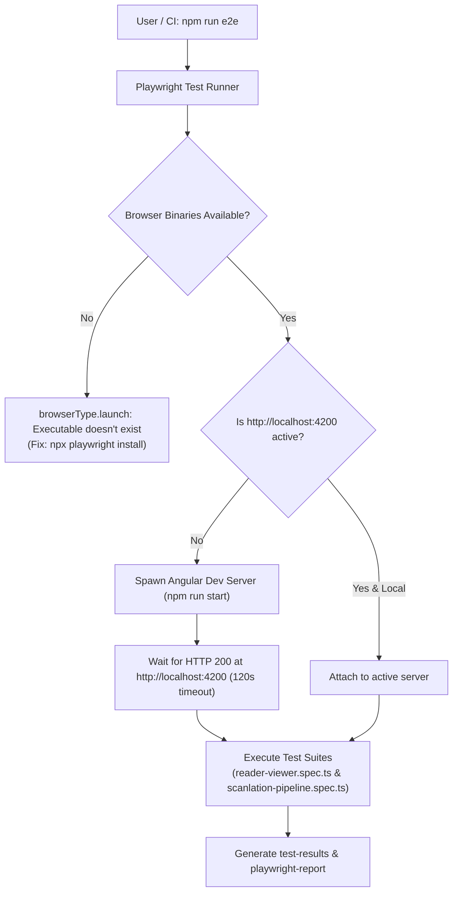

# Requirements

### Overview & Goals
Running `npm run e2e` currently fails immediately with `browserType.launch: Executable doesn't exist` across all 12 test permutations (Chromium, Firefox, WebKit, and Mobile Chrome) in `tests/e2e/reader-viewer.spec.ts` and `tests/e2e/scanlation-pipeline.spec.ts`. Furthermore, `frontend/playwright.config.ts` lacks an automated `webServer` lifecycle block, which would cause navigation failures (`ERR_CONNECTION_REFUSED`) once browsers are launched if the Angular dev server is not started beforehand. 

The goal of this plan is to resolve all underlying causes of E2E test failures, maximize developer productivity, and eliminate manual server orchestration.

### Scope
- **In Scope**:
  - Installing missing Playwright browser binaries (`npx playwright install`).
  - Updating `frontend/playwright.config.ts` with an automated `webServer` lifecycle configuration (`http://localhost:4200` with conditional reuse).
  - Adding deterministic timeouts (`timeout: 30000`, `expect: { timeout: 5000 }`) and artifact management (`outputDir: 'test-results'`).
  - Updating npm script definitions in `frontend/package.json` for cross-platform stability.
  - Verifying full execution of `tests/e2e/reader-viewer.spec.ts` and `tests/e2e/scanlation-pipeline.spec.ts`.
- **Out of Scope**:
  - Modifying Angular application components or backend API endpoints.
  - Modifying unit test configurations or Vitest setup.

### User Stories
- **As a developer**, I want to run `npm run e2e` from a clean repository state without manual prerequisites so that I can immediately verify end-to-end functionality.
- **As a CI/CD pipeline**, I want Playwright to launch its own ephemeral web server and produce detailed test reports/artifacts on failure so that regressions can be triaged efficiently.

### Functional Requirements
1. **Browser Binary Availability**: The environment must have all requisite Playwright browser engines (Chromium, Firefox, WebKit) installed.
2. **Automated Server Orchestration**: Running `npm run e2e` without a pre-existing server must automatically boot `npm run start` and wait for `http://localhost:4200` before running tests.
3. **Server Reuse in Development**: If `http://localhost:4200` is already running locally, Playwright must attach to it without restarting or failing with port conflicts.
4. **Diagnostic Artifact Capture**: On test failure or retry, Playwright must generate actionable traces, screenshots, and failure video captures in `frontend/test-results/` and an HTML report in `frontend/playwright-report/`.

### Non-Functional Requirements
- **Reliability & Efficiency**: Eliminate false-negative failures and maximize test execution speed through parallel workers and smart reuse.
- **Cross-Platform Portability**: Ensure scripts and configurations work seamlessly across Windows, Linux, and macOS.

# Technical Design

### Current Implementation & Root Causes
1. **Missing Browser Binaries**:
   Executing `npm run e2e` triggers `playwright test`, which attempts to launch Chromium (`chrome-headless-shell.exe`), Firefox (`firefox.exe`), and WebKit (`Playwright.exe`), but fails with:
   `browserType.launch: Executable doesn't exist`
   The browser binaries have not been downloaded to the local environment cache.
2. **Missing `webServer` in `playwright.config.ts`**:
   `frontend/playwright.config.ts` sets `baseURL: 'http://localhost:4200'`, but does not define a `webServer` block. Without this, Playwright cannot start the Angular application automatically, leading to connection failures on `page.goto('/read')` and `page.goto('/scanlation')`.
3. **Missing Explicit Timeouts & Artifact Directory**:
   No explicit `timeout` or `expect.timeout` is specified, and test artifacts are not channeled into a dedicated `test-results/` folder.

### Key Decisions
- **Decision 1: Install Playwright Browsers via CLI**:
  - *Choice*: Run `npx playwright install` in `frontend/`.
  - *Rationale*: Downloads and links the required browser engines for Chromium, Firefox, and WebKit to resolve the `Executable doesn't exist` launch error.
- **Decision 2: Automated `webServer` with Conditional Reuse**:
  - *Choice*: Add a `webServer` configuration block pointing to `npm run start` with `url: 'http://localhost:4200'`, `reuseExistingServer: !process.env['CI']`, and `timeout: 120 * 1000`.
  - *Rationale*: Eliminates the requirement to start the dev server manually in local development while maintaining clean isolation in CI environments.
- **Decision 3: Dedicated Artifact Management & Bounded Timeouts**:
  - *Choice*: Set `outputDir: 'test-results'`, global test timeout to `30_000ms`, assertion timeout to `5000ms`, and HTML reporter `open: 'never'`.
  - *Rationale*: Prevents runaway test runs, prevents interactive reporter popups from blocking headless/scripted runs, and centralizes failure diagnostics.

### Proposed Changes

#### `frontend/playwright.config.ts`
```typescript
import { defineConfig, devices } from '@playwright/test';

export default defineConfig({
  testDir: './tests/e2e',
  timeout: 30 * 1000,
  expect: {
    timeout: 5000
  },
  fullyParallel: true,
  forbidOnly: !!process.env['CI'],
  retries: process.env['CI'] ? 2 : 0,
  workers: process.env['CI'] ? 1 : undefined,
  outputDir: 'test-results',
  reporter: [
    ['html', { outputFolder: 'playwright-report', open: 'never' }],
    ['list']
  ],
  use: {
    baseURL: process.env['PLAYWRIGHT_BASE_URL'] || 'http://localhost:4200',
    trace: 'on-first-retry',
    screenshot: 'only-on-failure',
    video: 'retain-on-failure'
  },
  projects: [
    {
      name: 'chromium',
      use: { ...devices['Desktop Chrome'] }
    },
    {
      name: 'firefox',
      use: { ...devices['Desktop Firefox'] }
    },
    {
      name: 'webkit',
      use: { ...devices['Desktop Safari'] }
    },
    {
      name: 'Mobile Chrome',
      use: { ...devices['Pixel 5'] }
    }
  ],
  webServer: {
    command: 'npm run start',
    url: 'http://localhost:4200',
    reuseExistingServer: !process.env['CI'],
    timeout: 120 * 1000
  }
});
```

### Architecture Diagram


### Risks & Mitigations
- **Angular Startup Delay**: Initial TypeScript build and bundle generation in Angular may take 20–40 seconds. Setting `webServer.timeout` to 120 seconds prevents false timeouts during compilation.
- **Port 4200 In Use**: Setting `reuseExistingServer: !process.env['CI']` allows Playwright to reuse an existing dev server during local development rather than failing on port collision.

# Testing

### Validation Approach
Verify that `npm run e2e` executes all Playwright test suites across desktop and mobile browser projects successfully without requiring manual background server launches.

### Key Scenarios
1. **Cold Run (No background dev server)**:
   - Ensure browser binaries are installed (`npx playwright install`).
   - Run `npm run e2e`.
   - Verify that Playwright launches the Angular development server automatically, completes tests for `reader-viewer.spec.ts` and `scanlation-pipeline.spec.ts`, and shuts down the server cleanly on exit.
2. **Warm Run (Pre-existing dev server)**:
   - Start `npm start` in a separate process.
   - Run `npm run e2e`.
   - Verify that Playwright immediately attaches to `http://localhost:4200` without restarting the server or failing.
3. **Multi-Browser Verification**:
   - Verify tests pass across Chromium, Firefox, WebKit, and Mobile Chrome configurations.

### Edge Cases
- **Slow Compilation Timeout**: Ensure the 120s `webServer.timeout` handles slower initial cold compilations without premature test failures.
- **Failure Artifact Generation**: Verify that if a test fails, trace files, failure screenshots, and videos are correctly saved under `test-results/`.

# Delivery Steps

###   Step 1: Install Playwright browser binaries and dependencies
All required Playwright browser binaries (Chromium, Firefox, WebKit) are installed and ready for test execution.

- Execute Playwright browser installation (`npx playwright install` and required system dependencies where applicable) in the `frontend` directory.
- Verify that browser binaries for Chromium (`chrome-headless-shell`), Firefox, and WebKit are present in the local Playwright cache.
- Ensure the test runner can launch browser contexts without `browserType.launch: Executable doesn't exist` errors.

###   Step 2: Configure automated webServer lifecycle in Playwright configuration
Running `npm run e2e` automatically launches the Angular dev server on `http://localhost:4200` when inactive and reuses it when already active.

- Add a `webServer` configuration block to `frontend/playwright.config.ts` with `command: 'npm run start'` and target `url: 'http://localhost:4200'`.
- Configure `reuseExistingServer: !process.env['CI']` so developers can iterate quickly without restarting running dev servers, while maintaining clean isolation in CI.
- Set a generous server startup timeout (`120_000ms`) to accommodate Angular compilation time.
- Verify that `baseURL` falls back cleanly to `'http://localhost:4200'` or honors `PLAYWRIGHT_BASE_URL`.

###   Step 3: Refine timeouts, artifact management, and cross-platform npm scripts
Playwright configuration enforces deterministic timeouts, isolates failure artifacts, and supports cross-platform scripts.

- Configure global test timeout (`30_000ms`) and assertion timeout (`expect: { timeout: 5000 }`) in `frontend/playwright.config.ts`.
- Set `outputDir: 'test-results'` to store traces, screenshots, and videos on failure.
- Configure reporters (`html` with `open: 'never'`, `list`) for headless environments.
- Update `frontend/package.json` E2E script definitions to ensure cross-platform compatibility across Windows PowerShell/CMD and Unix shells.
- Run `npm run e2e` across all browser projects (`reader-viewer.spec.ts` and `scanlation-pipeline.spec.ts`) to confirm end-to-end success.