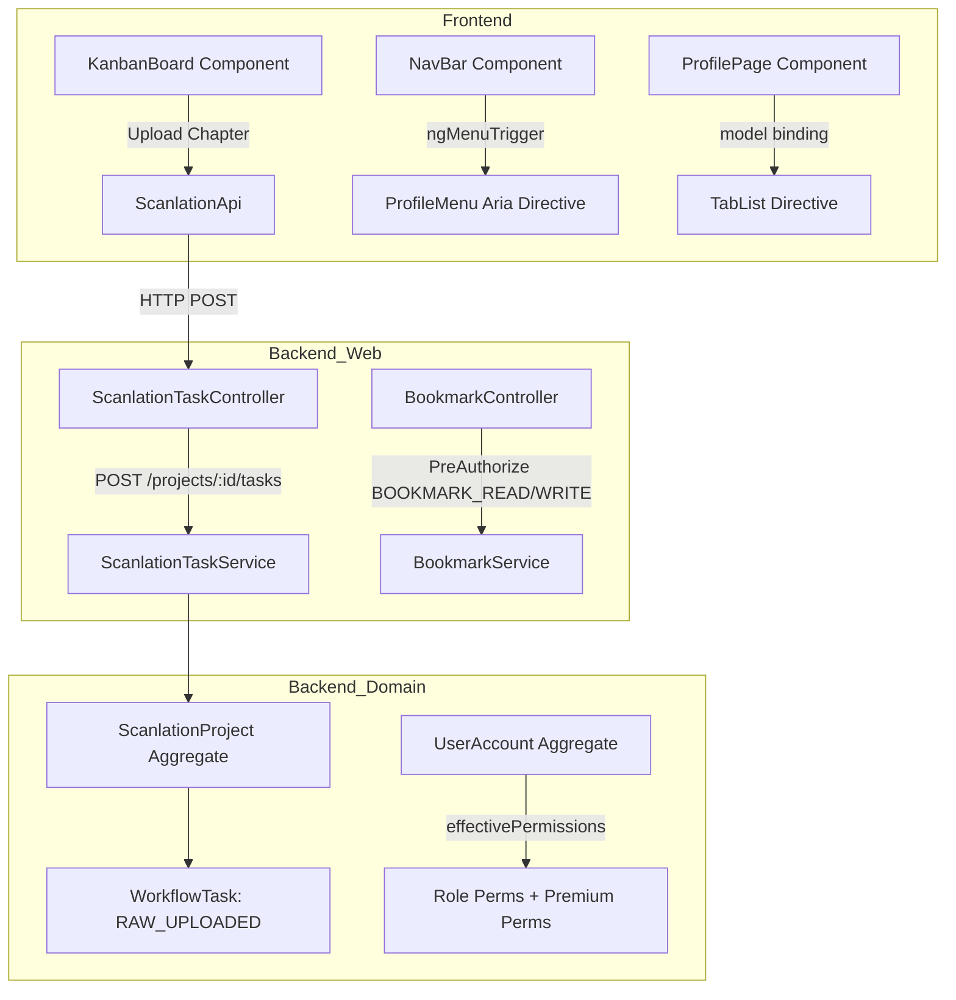

# Requirements

### Overview & Goals
The objective is to resolve frontend runtime errors during navigation and profile/subscription switching, correct the `@angular/aria` menu trigger toggle/close behavior, fix failing Playwright E2E test selectors, implement the missing chapter upload functionality with backend endpoints, frontend UI, and tests, and create a clear reference document (`ROLES_PERMISSIONS.md`) explaining Readora's 3-tier authorization model.

### Scope
- **In Scope:**
  - Fix frontend navbar profile menu open/close toggle directive binding (`@angular/aria`).
  - Fix profile page tab binding (`signal` vs `model` contract with `TabList`) and subscription switching errors.
  - Fix broken CSS/DOM selectors in Playwright test suites (`auth.spec.ts`, `catalog.spec.ts`, `reader.spec.ts`).
  - Implement backend chapter upload / workflow task creation in `readora-domain`, `readora-application`, and `readora-web`.
  - Implement frontend chapter upload modal in scanlation Kanban board with validation and state updates.
  - Comprehensive unit, integration, and E2E test suites for chapter upload.
  - Create `ROLES_PERMISSIONS.md` documenting global roles, subscription plan permissions, and project scanlation roles.
- **Out of Scope:**
  - Third-party cloud storage integration changes (existing `StoragePort` mock/local storage remains intact).
  - Stripe webhook contract alterations beyond existing subscription activation flows.

### User Stories
- **As a User**, I want to open and close the profile menu smoothly and switch between profile tabs and subscription pages without console errors.
- **As a Scanlator / Leader**, I want to upload new raw chapter packages to a scanlation project so that team members can claim cleaning, translation, typesetting, and QC tasks.
- **As a Developer**, I want all Playwright tests to pass green and have a clean reference file (`ROLES_PERMISSIONS.md`) explaining the roles, subscriptions, and permissions.

### Functional Requirements
1. **Navbar Profile Menu:**
   - Clicking the profile avatar button opens the dropdown menu.
   - Clicking outside, pressing `Escape`, or selecting a menu item closes the dropdown menu cleanly.
2. **Profile & Subscription Navigation:**
   - Navigating between `/profile` tabs (Overview, Settings) and `/subscription` plans loads data without Angular signal/model binding errors.
3. **Chapter Upload Flow:**
   - Scanlators with `TASK_CLAIM` or `PROJECT_MANAGE` permission can upload a chapter number, asset archive/URL, and page count for a project.
   - Backend creates a `WorkflowTask` at `RAW_UPLOADED` stage and registers domain events.
   - Frontend Kanban board immediately shows the new chapter in the Raw Uploaded column.
4. **Roles & Permissions Documentation:**
   - Clear markdown documentation explaining the 3 authorization layers and access control matrix.

### Roles & Permissions Architecture Explanation
Readora uses a **3-tier authorization system**:
1. **Global User Account Roles (`Role` enum):**
   - `READER`: Base consumer role. Has permissions: `COMMENT_WRITE`, `COMMENT_UPVOTE`.
   - `SCANLATOR`: Contributor role. Has permissions: `COMMENT_WRITE`, `COMMENT_UPVOTE`, `PROJECT_VIEW`, `TASK_CLAIM`, `TASK_SUBMIT`, `CHAPTER_PUBLISH`.
   - `ADMIN`: Administrator role. Has all permissions: `COMMENT_WRITE`, `COMMENT_UPVOTE`, `BOOKMARK_READ`, `BOOKMARK_WRITE`, `TASK_CLAIM`, `TASK_SUBMIT`, `CHAPTER_PUBLISH`, `PROJECT_VIEW`, `PROJECT_MANAGE`, `USER_MANAGE`.
2. **Subscription Plans (`SubscriptionPlan` enum - Dynamic Permissions):**
   - `FREE`: No extra permissions.
   - `PREMIUM`: Dynamically grants `BOOKMARK_READ` and `BOOKMARK_WRITE` when active, allowing cross-device reading progress synchronization and bookmarking.
   - *Effective Permissions* = `Role.permissions` $\cup$ `(Subscription.isActive ? SubscriptionPlan.permissions : $\emptyset$)`.
3. **Scanlation Project Team Roles (`ScanlationRole` enum - Project Scoped):**
   - Members assigned to specific projects have roles: `LEADER`, `CLEANER`, `TRANSLATOR`, `TYPESETTER`, `QC`.
   - Controls which pipeline stage tasks they can claim and submit:
     - `RAW_UPLOADED` $\rightarrow$ `CLEANER`
     - `TRANSLATING` $\rightarrow$ `TRANSLATOR`
     - `TYPESETTING` $\rightarrow$ `TYPESETTER`
     - `QUALITY_CHECK` $\rightarrow$ `QC`
     - `LEADER` has full claim/submit privileges across all stages.

# Technical Design

### Current Implementation & Root Causes
1. **Navbar Menu Toggle:**
   - `frontend/src/app/features/layout/nav-bar.html` incorrectly uses `[ngMenuTrigger]="profileMenu"` instead of directive attribute with input `ngMenuTrigger [menu]="profileMenu"`, preventing `@angular/aria` from managing trigger state.
2. **Profile Tab Two-Way Binding:**
   - In `frontend/src/app/features/profile/profile-page.ts`, `selectedTab` is defined as `signal<ProfileTab>('overview')` while `TabList` expects a `model()` for `[(selectedTab)]="selectedTab"`, causing runtime binding issues.
3. **Playwright E2E Selectors:**
   - `auth.spec.ts`: Selector syntax `button[type="submit"]` has nested quote escaping issues.
   - `catalog.spec.ts`: Card selector queries `div.group` whereas `WorkCard` renders `<article class="group ...">`.
   - `reader.spec.ts`: Chapter item selector queries `button.text-left` whereas `ChapterList` renders `<a class="text-left ...">`.
4. **Missing Chapter Upload Feature:**
   - `ScanlationProject` aggregate supports `addChapterTask(ChapterNumber)`, but no application use case or REST controller endpoint was exposed to upload a new raw chapter package, nor was there a UI dialog on the Kanban board.

### Key Decisions
1. **Chapter Upload API Endpoint:**
   - Implement `POST /api/v1/scanlation/projects/{projectId}/tasks` accepting `{ chapterNumber, assetUrl, pageCount }`.
   - Endpoint enforces `@PreAuthorize("hasAuthority('TASK_CLAIM') or hasAuthority('PROJECT_MANAGE')")` and checks project membership.
2. **Frontend Kanban Upload Modal:**
   - Add a lightweight dialog component in `frontend/src/app/features/scanlation/components/kanban-board.ts` with reactive forms and validation, invoking `ScanlationApi.createTask(...)`.
3. **Role & Permission Documentation:**
   - Place `ROLES_PERMISSIONS.md` at project root with detailed explanation and comparison tables between global roles, subscription entitlements, and scanlation project roles.

### Architecture Diagram


### Data Models / Contracts
#### Chapter Upload Request & DTO
```java
public record CreateTaskRequest(
    @NotNull @Positive BigDecimal chapterNumber,
    @NotBlank String assetUrl,
    @Positive int pageCount
) {}
```

#### TypeScript API Client Additions
```typescript
export interface CreateTaskRequest {
  chapterNumber: number;
  assetUrl: string;
  pageCount: number;
}

// In ScanlationApi:
createTask(projectId: string, request: CreateTaskRequest): Observable<WorkflowTaskDto>;
```

### File Structure
- **Frontend Changes:**
  - `frontend/src/app/features/layout/nav-bar.html` (fix menu trigger syntax)
  - `frontend/src/app/features/profile/profile-page.ts` (convert `selectedTab` to `model<ProfileTab>`)
  - `frontend/src/app/features/scanlation/components/kanban-board.ts` & `.html` (add chapter upload dialog)
  - `frontend/src/app/core/api/scanlation-api.ts` (add `createTask` method)
  - `frontend/tests/e2e/auth.spec.ts` (fix submit selector)
  - `frontend/tests/e2e/catalog.spec.ts` (fix work card selector)
  - `frontend/tests/e2e/reader.spec.ts` (fix chapter link selector)
- **Backend Changes:**
  - `backend/readora-application/src/main/java/com/readora/application/port/in/ManageScanlationTaskUseCase.java` (add `createTask`)
  - `backend/readora-application/src/main/java/com/readora/application/service/ScanlationTaskService.java` (implement `createTask`)
  - `backend/readora-web/src/main/java/com/readora/web/controller/ScanlationTaskController.java` (add `POST /tasks`)
  - `backend/readora-web/src/main/java/com/readora/web/dto/CreateTaskRequest.java` (request DTO)
- **Documentation:**
  - `ROLES_PERMISSIONS.md` (root directory)

# Testing

### Validation Approach
Verification combines backend unit & Spring MockMvc integration tests, Angular unit & component tests, and end-to-end Playwright tests running in headless Chromium.

### Key Scenarios
1. **Menu & Navigation:**
   - Clicking profile menu trigger opens menu; clicking outside or pressing `Escape` closes it.
   - Navigating between `/profile` tabs and `/subscription` renders without console exceptions.
2. **Playwright E2E Suites:**
   - `auth.spec.ts`: User registration, login, token refresh, and logout.
   - `catalog.spec.ts`: Work listing, search filtering, and detail navigation.
   - `reader.spec.ts`: Chapter opening, page scrolling, and reading progress saving (for premium users).
3. **Chapter Upload Flow:**
   - Scanlator uploads Chapter 1 raw images (URL: `scans/work-1/1/raw.zip`, pages: 20).
   - Task appears under `RAW_UPLOADED` on Kanban board.
   - Cleaner can claim task and submit work to advance to `TRANSLATING`.
   - Reader cannot upload chapter (returns 403 Forbidden).

### Edge Cases
- Submitting duplicate chapter number for the same project returns 400 Bad Request / DomainValidationException.
- Non-project member trying to upload or claim tasks is rejected with access denied.
- Zero or negative page count rejected by bean validation.
- Free user attempting bookmark writes receives 403 Forbidden while Premium user succeeds.

### Test Changes
- `readora-application`: Add `ScanlationTaskServiceTest` verifying `createTask` saves project and emits domain event.
- `readora-web`: Add `ScanlationTaskControllerIntegrationTest` testing `POST /api/v1/scanlation/projects/{projectId}/tasks`.
- `frontend`: Add Kanban board component test verifying the chapter upload modal trigger and submission.
- `frontend/tests/e2e`: Update selectors across `auth.spec.ts`, `catalog.spec.ts`, and `reader.spec.ts`, and add `scanlation.spec.ts` for chapter upload.

# Delivery Steps

### ✓ Step 1: Fix frontend menu trigger, profile tab navigation, and routing state errors
Frontend navigation and profile menu open/close interactions work reliably without console errors or layout stuck states.

- Fix the `@angular/aria` menu trigger binding in `frontend/src/app/features/layout/nav-bar.html` by updating directive syntax to `ngMenuTrigger [menu]="profileMenu"` and ensuring click-outside / escape dismissal works smoothly.
- Resolve the profile tab two-way binding mismatch in `frontend/src/app/features/profile/profile-page.ts` by replacing `signal<ProfileTab>` with `model<ProfileTab>` (or explicit setter) to correctly align with `@angular/aria` `TabList.selectedTab` two-way contract.
- Fix active tab and route synchronization between profile overview/settings and subscription plan views.

### ✓ Step 2: Fix Playwright E2E test selectors and assertions
All Playwright E2E test suites pass reliably across auth, catalog, reader, and subscription flows.

- Fix invalid attribute selector escaping in `frontend/tests/e2e/auth.spec.ts` (`button[type=submit]`).
- Fix catalog item card selector in `frontend/tests/e2e/catalog.spec.ts` to match `article.group` rendered by `WorkCard`.
- Update reader navigation and chapter selection selectors in `frontend/tests/e2e/reader.spec.ts` to target `a.text-left` chapter links and proper reading progress controls.
- Add assertions verifying subscription page navigation and active premium status indicators.

### ✓ Step 3: Implement chapter upload backend endpoints, services, and tests
Backend supports secure chapter uploading and pipeline task initialization with complete unit and integration test coverage.

- Add `uploadChapterTask(ProjectId, ChapterNumber, String assetUrl, int pageCount, UserId userId)` to `ManageScanlationTaskUseCase` and implement it in `ScanlationTaskService`.
- Add `POST /api/v1/scanlation/projects/{projectId}/tasks` endpoint in `ScanlationTaskController` protected with `@PreAuthorize("hasAuthority('TASK_CLAIM') or hasAuthority('PROJECT_MANAGE')")`.
- Implement chapter drafting or updating in `ChapterRepositoryPort` when initial RAW chapter assets are uploaded.
- Add unit tests in `readora-application` and integration tests in `readora-web` for chapter upload permissions, validation, and domain event dispatching.

### ✓ Step 4: Implement frontend chapter upload modal in scanlation board and create ROLES_PERMISSIONS.md documentation
Scanlators can upload new chapters from the frontend kanban board, and comprehensive documentation of roles and permissions is established.

- Add an "Upload Chapter" button and upload dialog/form in `frontend/src/app/features/scanlation/components/kanban-board.ts` and template to submit new chapter workflow tasks.
- Connect the upload dialog to `ScanlationApi` and update `ScanlationState` to refresh columns after upload.
- Add unit/component tests in frontend for chapter upload and new Playwright E2E test for the chapter upload flow.
- Author `ROLES_PERMISSIONS.md` at repository root with comprehensive tables detailing global account roles (`READER`, `SCANLATOR`, `ADMIN`), dynamic subscription permissions (`FREE`, `PREMIUM`), and project team roles (`LEADER`, `CLEANER`, `TRANSLATOR`, `TYPESETTER`, `QC`).