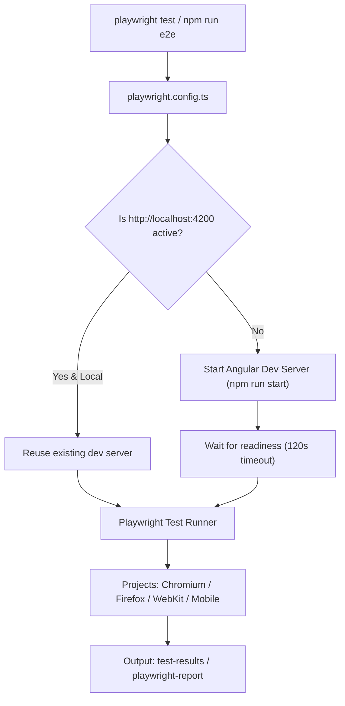

# Requirements

### Overview & Goals
The objective is to fix configuration deficiencies and reliability gaps in `frontend/playwright.config.ts`. Currently, the Playwright configuration lacks an automated `webServer` lifecycle hook, explicit timeout bounds, centralized artifact directory management, and cross-platform execution robustness. Resolving these issues maximizes developer productivity, minimizes compute waste, eliminates flaky test runs, and provides a streamlined test execution experience across both local environments and CI/CD pipelines.

### Scope
- **In Scope**:
  - Updating `frontend/playwright.config.ts` with an automated `webServer` configuration to launch the Angular development server on demand.
  - Defining deterministic global test and assertion timeouts (`timeout`, `expect.timeout`) to prevent hanging processes.
  - Configuring artifact directories (`outputDir: 'test-results'`) and optimized reporters (`html`, `list`, `github`).
  - Refining browser/device project definitions for comprehensive desktop and mobile coverage.
  - Ensuring cross-platform compatibility across Windows, Linux, and macOS environments.
- **Out of Scope**:
  - Rewriting existing Angular application components or backend services.
  - Modifying the underlying Vitest unit test suite configuration (`tsconfig.spec.json` / `angular.json`).

### Functional Requirements
1. **Automated Server Lifecycle**: Running `npm run e2e` directly from a fresh terminal must automatically spin up the Angular development server (`http://localhost:4200`) if not already active.
2. **Server Reuse in Development**: Local test runs should reuse an already running dev server without restarting it, while CI runs must start a fresh isolated instance.
3. **Artifact Retention on Failure**: Diagnostic artifacts (traces, failure screenshots, failure videos) must be cleanly captured and stored in `test-results/` only upon failure or retry to optimize disk and storage efficiency.
4. **Deterministic Timeout Handling**: Playwright must enforce strict test timeouts (30s) and assertion timeouts (5s) to ensure fast feedback loops and prevent hung worker threads.
5. **Cross-Browser Verification**: The configuration must execute against desktop engines (Chromium, Firefox, WebKit) and representative mobile viewports.

### Non-Functional Requirements
- **Efficiency & Utility**: Minimize startup delays and avoid unnecessary compilation cycles during repeated local test runs.
- **Cross-Platform Compatibility**: Fully functional on Windows PowerShell/CMD, Linux bash, and macOS zsh environments.
- **Maintainability**: Clear, declarative configuration adhering to official `@playwright/test` best practices.

# Technical Design

### Current Implementation
The existing `frontend/playwright.config.ts` provides a baseline configuration:
- Sets `testDir: './tests/e2e'` and defines projects for Chromium, Firefox, WebKit, and Mobile Chrome.
- Sets `baseURL` to `process.env['PLAYWRIGHT_BASE_URL'] || 'http://localhost:4200'`.
- **Gaps Identified**:
  - Missing `webServer` block: tests fail immediately with connection refused errors if `npm start` was not manually launched beforehand.
  - Missing explicit `timeout` and `expect.timeout` limits.
  - Missing explicit `outputDir` definition, causing runtime artifacts to pollute standard working directories.
  - Reporter config opens reports interactively in environments where headless execution is required.

### Key Decisions
- **Decision 1: Add `webServer` with conditional reuse**:
  - *Choice*: Configure `webServer` targeting `npm run start` (or `npx ng serve`) with `reuseExistingServer: !process.env['CI']`.
  - *Rationale*: Maximizes developer convenience locally by eliminating manual server startups while maintaining test isolation in CI.
- **Decision 2: Explicit Timeouts and Failure-Only Artifacts**:
  - *Choice*: Set `timeout: 30000`, `expect: { timeout: 5000 }`, `trace: 'on-first-retry'`, `screenshot: 'only-on-failure'`, `video: 'retain-on-failure'`.
  - *Rationale*: Protects CI and developer machines against runaway execution times and avoids disk bloat by storing diagnostic data only when failures occur.
- **Decision 3: Dedicated Output Directory**:
  - *Choice*: Set `outputDir: 'test-results'`.
  - *Rationale*: Isolates ephemeral test artifacts from source code and build distributions.

### Proposed Changes
Update `frontend/playwright.config.ts` to include:
```typescript
import { defineConfig, devices } from '@playwright/test';

export default defineConfig({
  testDir: './tests/e2e',
  timeout: 30 * 1000,
  expect: {
    timeout: 5000
  },
  fullyParallel: true,
  forbidOnly: !!process.env['CI'],
  retries: process.env['CI'] ? 2 : 0,
  workers: process.env['CI'] ? 1 : undefined,
  outputDir: 'test-results',
  reporter: [
    ['html', { outputFolder: 'playwright-report', open: 'never' }],
    ['list']
  ],
  use: {
    baseURL: process.env['PLAYWRIGHT_BASE_URL'] || 'http://localhost:4200',
    trace: 'on-first-retry',
    screenshot: 'only-on-failure',
    video: 'retain-on-failure'
  },
  projects: [
    {
      name: 'chromium',
      use: { ...devices['Desktop Chrome'] }
    },
    {
      name: 'firefox',
      use: { ...devices['Desktop Firefox'] }
    },
    {
      name: 'webkit',
      use: { ...devices['Desktop Safari'] }
    },
    {
      name: 'Mobile Chrome',
      use: { ...devices['Pixel 5'] }
    },
    {
      name: 'Mobile Safari',
      use: { ...devices['iPhone 12'] }
    }
  ],
  webServer: {
    command: 'npm run start',
    url: 'http://localhost:4200',
    reuseExistingServer: !process.env['CI'],
    timeout: 120 * 1000
  }
});
```

### Architecture Diagram


### Risks & Mitigations
- **Port Conflict / Lingering Process**: `webServer` configuration checks `http://localhost:4200` and gracefully reuses an active instance in development.
- **Slow Initial Build Compilation**: Set `webServer.timeout` to 120 seconds to give the Angular compilation phase ample time to complete before tests begin executing.

# Testing

### Validation Approach
Verify that Playwright E2E tests run seamlessly both with and without a pre-existing development server instance, ensuring high test execution reliability and diagnostic completeness.

### Key Scenarios
1. **Cold Start Execution**:
   - Run `npm run e2e` with no background servers running.
   - Verify that Playwright automatically launches the Angular dev server, awaits readiness at `http://localhost:4200`, and runs all test suites to completion.
2. **Warm Start / Reuse Execution**:
   - Start `npm start` in a separate terminal.
   - Run `npm run e2e`.
   - Verify that Playwright connects immediately to the running server without port collision or restarting.
3. **Artifact Generation on Test Failure**:
   - Trigger an intentional expectation failure in an E2E test.
   - Verify that `test-results/` captures screenshots, trace files, and videos, and `playwright-report/` generates an actionable HTML report.

### Edge Cases
- **Slow Compilation Timeout**: Ensure the 120s startup timeout prevents false-negative failures on slower CI runners or loaded development machines.
- **CI Environment Detection**: Verify that setting `CI=true` enforces single-worker isolation (`workers: 1`), automatic retries (`retries: 2`), `forbidOnly`, and clean server provisioning.

# Delivery Steps

###   Step 1: Configure automated webServer lifecycle and baseURL resolution
Configure automatic web server startup and lifecycle management in `frontend/playwright.config.ts` so tests can run without manual server pre-launch.

- Add a `webServer` block pointing to `npm run start` (or `npx ng serve`) with target URL `http://localhost:4200`.
- Enable `reuseExistingServer: !process.env['CI']` to maximize local iteration speed and avoid port conflicts.
- Configure server startup timeout (`120_000ms`) and output piping for reliable startup detection.
- Validate `baseURL` default resolution from `process.env['PLAYWRIGHT_BASE_URL'] || 'http://localhost:4200'`.

###   Step 2: Configure timeouts, artifact output directories, and reporters
Configure deterministic timeouts, artifact management, and contextual reporting in `frontend/playwright.config.ts` to prevent resource waste and accelerate triage.

- Set explicit global test timeout (`30_000ms`) and assertion timeout (`expect: { timeout: 5000 }`) to prevent stalled runner executions.
- Define `outputDir: 'test-results'` for clean separation of traces, screenshots, and failure video recordings.
- Configure reporters dynamically based on execution environment (e.g., `html` with `open: 'never'`, `list` for local terminal, or `github` annotations in CI).

###   Step 3: Refine device projects matrix and cross-platform script execution
Ensure comprehensive cross-platform execution and cross-device coverage across mobile and desktop browser targets.

- Verify and refine the `projects` matrix to support Chromium, Firefox, WebKit, and mobile viewport simulations (Mobile Chrome, Mobile Safari).
- Optimize script definitions in `frontend/package.json` for cross-platform compatibility without shell-specific inline env assignments.
- Validate that all existing E2E test suites (`reader-viewer.spec.ts` and `scanlation-pipeline.spec.ts`) execute cleanly against the updated configuration.