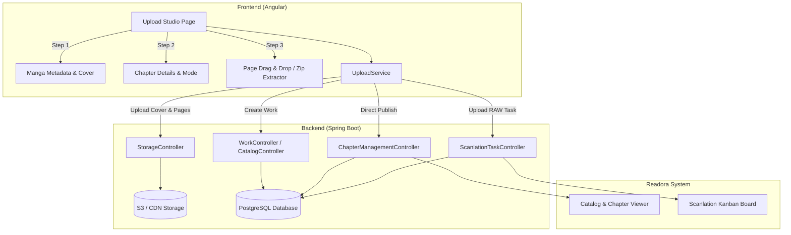

# Requirements

### Overview & Goals
Currently, Readora supports reading published chapters and managing scanlation tasks through a Kanban board, but lacks a user-facing way to upload a new Manga/Series and its chapter pages from the frontend.

The goal of this feature is to deliver a modern, simple, and intuitive **Upload Studio** UI in Readora that allows creators and scanlation teams to:
1. Create new Manga, Manhwa, Manhua, or Comic entries with metadata and cover image upload.
2. Upload chapter pages easily using drag-and-drop multi-file selection or `.zip`/`.cbz` archives.
3. Choose between **Direct Instant Publishing** (live immediately in the public catalog) and **Scanlation Workflow** (raw upload into the team Kanban pipeline).

---

### Scope

#### In Scope
- **Backend Work Management**: REST API to create and manage `Work` entities (title, synopsis, type, genres, cover URL).
- **Backend Asset Storage API**: Multipart file upload endpoints for cover images and chapter page packages, backed by `StoragePort`.
- **Backend Chapter Direct Publishing**: Ability to create and publish a chapter with ordered pages directly without requiring full scanlation pipeline cycles.
- **Frontend Upload Studio (`/upload`)**: A dedicated multi-step wizard guiding creators through Manga creation, Cover Upload, Chapter setup, and Page Upload.
- **Client-Side File Processing**: Drag-and-drop multi-image uploads, thumbnail preview, drag-to-reorder, and client-side `.zip`/`.cbz` archive extraction.
- **Shell & Navigation Integration**: "Upload" CTA button in the main navigation header and on the Catalog page for authorized users.

#### Out of Scope
- Automated AI translation or optical character recognition (OCR).
- Video / animated webtoon rendering extensions.
- Digital rights management (DRM) encryption on individual static images.

---

### User Stories
- **As a Manga Creator / Scanlator**, I want to upload a new manga series with its title, cover image, and metadata through a clean UI so that readers can discover it in the catalog.
- **As a Solo Creator**, I want to upload chapter images and publish them directly to the catalog in one simple flow without mandatory multi-stage QC queues.
- **As a Scanlation Team Leader**, I want to upload raw chapter packages into our team's scanlation project board to kick off translation and cleaning tasks.
- **As a Reader**, I want newly uploaded manga and chapters to be instantly readable in the reader viewer with correct page ordering.

---

### Functional Requirements

1. **Work Creation**:
   - Form inputs: Title (required, 1-255 chars), Type (MANGA, MANHWA, MANHUA, COMIC), Status (ONGOING, COMPLETED, HIATUS), Genres (multi-select/tags), Synopsis.
   - Cover image picker with drag-and-drop, client-side preview, format validation (JPEG, PNG, WebP), and automatic CDN upload.

2. **Chapter Upload & Publishing**:
   - Chapter number (e.g., `1`, `1.5`, `10`), Chapter Title (optional).
   - Publishing Mode Selector:
     - **Direct Publish**: Generates `Chapter` and `PageAsset` records marked as `PUBLISHED` immediately.
     - **Scanlation Pipeline**: Creates a `WorkflowTask` in `RAW_UPLOADED` stage attached to the work's project.

3. **Page Asset Manager UI**:
   - Drag-and-drop zone accepting multiple image files or `.zip`/`.cbz` archives.
   - Natural alphanumeric page sorting (e.g., `01.jpg`, `02.jpg`, `10.jpg`).
   - Thumbnail grid with page numbering, visual drag-to-reorder, single-page deletion, and upload progress indicators.

4. **Access Control & Permissions**:
   - Upload features accessible to authenticated users with `SCANLATOR` or `ADMIN` roles (or users with `WORK_CREATE` authority).
   - Readers attempting to access `/upload` receive a prompt to register as a creator/scanlator.

# Technical Design

### Current Implementation
- **Backend**:
  - `Work` and `Chapter` aggregates exist in `readora-domain`.
  - `CatalogService` / `CatalogController` only implement read-only browsing (`GET /api/v1/works/**`).
  - `ScanlationTaskService` supports uploading raw assets by URL string into existing scanlation projects, but there is no endpoint to create works or upload files directly.
  - `StoragePort` / `S3StorageAdapter` provide S3/CDN upload URL generation.
- **Frontend**:
  - Angular 19+ standalone component architecture with signal-based state.
  - `WorksPage` (`/works`) and `WorkDetailPage` (`/works/:workId`) display catalog works and chapters.
  - `KanbanBoard` (`/scanlation/:projectId`) handles task claim/progression, but lacks direct file upload.

---

### Key Decisions
1. **Dedicated Upload Studio Route (`/upload`)**: Provides a focused, distraction-free multi-step wizard rather than cramped modal dialogs.
2. **Dual Direct & Scanlation Pipeline**:
   - Solo creators can choose **Direct Publish** to immediately create published chapters and page assets.
   - Scanlation teams can choose **Scanlation Workspace** to create raw tasks in the pipeline.
3. **Hybrid File Upload**:
   - Backend provides `POST /api/v1/storage/upload` for multipart image processing and local/S3 persistence, alongside presigned URL support.
   - Frontend supports both raw image file lists and `.zip`/`.cbz` extraction in-browser using JSZip before uploading.

---

### Architecture Diagram



---

### Data Models & Contracts

#### 1. Create Work Request (`POST /api/v1/works`)
```json
{
  "title": "Solo Leveling",
  "synopsis": "Ten years ago, the Gates opened...",
  "type": "MANHWA",
  "status": "ONGOING",
  "coverImageUrl": "https://cdn.readora.com/covers/solo-leveling.webp",
  "genres": ["Action", "Fantasy", "Adventure"]
}
```

#### 2. Direct Publish Chapter Request (`POST /api/v1/works/{workId}/chapters/direct`)
```json
{
  "chapterNumber": "1",
  "title": "I'm Used to It",
  "pages": [
    { "pageNumber": 1, "storageKey": "scans/work-id/c1/p1.webp", "cdnUrl": "https://cdn.readora.com/scans/work-id/c1/p1.webp" },
    { "pageNumber": 2, "storageKey": "scans/work-id/c1/p2.webp", "cdnUrl": "https://cdn.readora.com/scans/work-id/c1/p2.webp" }
  ]
}
```

#### 3. Storage Upload Response (`POST /api/v1/storage/upload`)
```json
{
  "status": 200,
  "data": {
    "storageKey": "scans/raw/uuid-p1.webp",
    "cdnUrl": "https://cdn.readora.com/scans/raw/uuid-p1.webp"
  }
}
```

---

### Components & File Structure

#### Backend Files
- `backend/readora-application/src/main/java/com/readora/application/port/in/ManageWorkUseCase.java` (New)
- `backend/readora-application/src/main/java/com/readora/application/port/in/DirectPublishChapterUseCase.java` (New)
- `backend/readora-application/src/main/java/com/readora/application/service/WorkManagementService.java` (New)
- `backend/readora-web/src/main/java/com/readora/web/controller/WorkManagementController.java` (New or extend `CatalogController`)
- `backend/readora-web/src/main/java/com/readora/web/controller/StorageController.java` (New)
- `backend/readora-web/src/main/java/com/readora/web/dto/CreateWorkRequest.java` (New)
- `backend/readora-web/src/main/java/com/readora/web/dto/DirectPublishChapterRequest.java` (New)

#### Frontend Files
- `frontend/src/app/core/upload/upload.service.ts` (New)
- `frontend/src/app/core/upload/file-utils.ts` (New: image natural sorting, zip extraction)
- `frontend/src/app/features/upload/upload-studio-page.ts` (New)
- `frontend/src/app/features/upload/upload-studio-page.html` (New)
- `frontend/src/app/features/upload/upload-studio-page.css` (New)
- `frontend/src/app/features/upload/components/page-grid-uploader.ts` (New)
- `frontend/src/app/features/layout/shell.html` (Updated: add Upload button)
- `frontend/src/app/features/catalog/works-page.html` (Updated: add Create Series CTA)
- `frontend/src/app/app.routes.ts` (Updated: add `/upload` route with permission guard)

---

### Risks & Mitigations
- **Large Payload / Network Drops**: Support per-file progress indicators and batch chunking so single-page failure does not abort the entire chapter upload.
- **Unordered Page Uploads**: Natural sorting on file names (`1.png`, `2.png`, `10.png`) plus intuitive drag-to-reorder preview before submission.
- **Storage Quota & Security**: Validate MIME types (JPEG, PNG, WebP) and file sizes server-side before persisting assets.

# Testing

### Validation Approach
Verification will be conducted through automated unit and integration tests across both the backend application/web layers and frontend components/services.

---

### Key Scenarios

1. **Manga Series Creation Flow**:
   - Verify valid manga metadata and cover image generates a new `Work` in PostgreSQL with proper `WorkId` and fields.
   - Verify newly created work appears immediately in the public catalog list (`/works`).

2. **Direct Chapter Publishing Flow**:
   - Verify uploading a set of 10 pages with `Direct Publish` mode creates a published `Chapter` and 10 `PageAsset` records.
   - Verify chapter is immediately accessible in the reader viewer (`/read/{chapterId}`) with pages in ascending order.

3. **Scanlation Pipeline Upload Flow**:
   - Verify uploading chapter assets with `Scanlation Workflow` mode creates a `WorkflowTask` in `RAW_UPLOADED` state.
   - Verify task appears in the scanlation Kanban board under the Raw column.

4. **File Drag & Drop and Archive Processing**:
   - Verify batch drag & drop correctly sorts files numerically (e.g. `page_1.png` to `page_20.png`).
   - Verify `.zip`/`.cbz` file drops are extracted into individual pages with preview thumbnails.

---

### Edge Cases
- Empty or invalid title submitted for work creation (expect HTTP 400 with validation error message).
- Duplicate chapter number for the same work (expect conflict error with user-friendly toast).
- Unsupported file format (e.g. `.exe` or corrupted image) uploaded as cover or page (expect client-side and server-side rejection).
- Non-authenticated user accessing `/upload` (expect redirect to login with return URL preserved).

---

### Test Changes
- `WorkManagementServiceTest.java`: Unit tests for work validation and creation logic.
- `WorkManagementControllerIntegrationTest.java`: Spring Boot mock MVC integration test for `POST /api/v1/works` and `POST /api/v1/works/{id}/chapters/direct`.
- `StorageControllerIntegrationTest.java`: File upload validation and storage adapter test.
- `upload.service.spec.ts`: Unit tests for file sorting, zip unpacking, and batch upload handling.
- `upload-studio-page.spec.ts`: Component test for form validation, step navigation, and upload triggers.

# Delivery Steps

###   Step 1: Implement backend storage and work management APIs
The backend exposes secure endpoints to store image assets, create new works (manga/manhwa/comics), and query creator projects.

- Implement `CreateWorkUseCase` and `ManageWorkUseCase` in `readora-application` with validation for title, synopsis, work type, genres, and cover image.
- Create `StorageController` in `readora-web` for handling multipart image asset uploads and presigned URL generation via `StoragePort`.
- Extend `CatalogController` with `POST /api/v1/works` requiring appropriate permissions (`WORK_CREATE` / `SCANLATOR` / `ADMIN`).
- Create database migration script if new fields/indexes are needed and wire service beans in `DomainServiceConfig`.
- Add backend unit and integration tests verifying work creation, validation constraints, and file storage.

###   Step 2: Implement chapter direct publishing and scanlation integration
The backend supports both instant direct chapter publishing to the catalog and submission into the scanlation pipeline.

- Implement `DirectPublishChapterUseCase` in `readora-application` to create published chapters with ordered `PageAsset`s directly.
- Add endpoint `POST /api/v1/works/{workId}/chapters/direct` in `CatalogController` or `ChapterManagementController` for creators to upload and instantly publish chapters.
- Enhance `ScanlationTaskService` and `ScanlationTaskController` to support direct page asset attachments from uploaded files.
- Automatically associate or create a default `ScanlationProject` when a work is created so creators can manage their pipeline seamlessly.
- Add acceptance and integration tests for both direct publishing and scanlation pipeline stage creation.

###   Step 3: Implement frontend upload and file processing services
Frontend provides robust services for uploading images, parsing `.zip`/`.cbz` archives client-side, and communicating with backend endpoints.

- Create `UploadService` in `frontend/src/app/core/upload/` providing methods for cover upload, batch page uploads, and archive extraction.
- Create utility for client-side image ordering (natural sort `p1.png`, `p2.png`, `p10.png`), aspect ratio validation, and preview generation.
- Integrate permissions (`WORK_CREATE`, `TASK_CLAIM`) into navigation guards and header menus to ensure authorized access.
- Add unit tests for `UploadService` verifying file batching, error recovery, and archive unpacking.

###   Step 4: Build the Upload Studio UI and integrate with Readora shell
The frontend has a dedicated, intuitive Upload Studio (`/upload`) with a step-by-step wizard for manga metadata and chapter page management.

- Create `UploadStudioPage` in `frontend/src/app/features/upload/` featuring a modern step-by-step wizard:
  - Step 1: **Manga Details** (Title, Type, Status, Genres, Synopsis, Drag-and-Drop Cover Image with live preview).
  - Step 2: **Chapter Details** (Chapter Number, Title, Publishing Mode: *Direct Live Release* vs. *Scanlation Workflow*).
  - Step 3: **Page Uploader** (Drag-and-drop multi-image / zip uploader with thumbnail grid, reordering, and delete actions).
  - Step 4: **Summary & Confirmation** (Validation check and progress bar for batch uploading).
- Add "Upload Manga" action button in the primary header navigation (`shell.html`) and catalog page (`works-page.html`).
- Wire navigation redirects to the newly created work page or scanlation workspace upon successful upload.
- Verify end-to-end user flow across all supported browsers and viewport sizes.