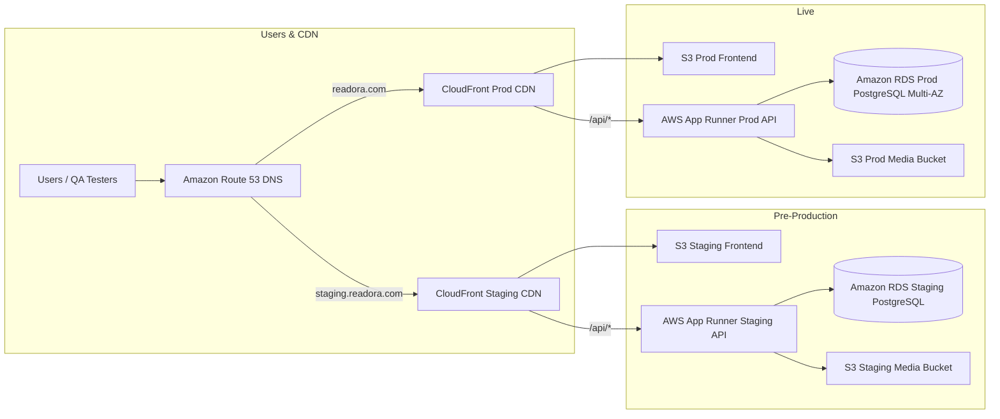
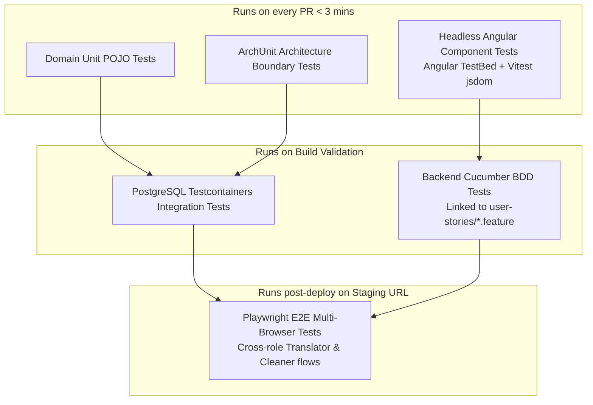

# Requirements

### Overview & Goals
Readora is a modern, high-utility web platform designed to unify manga/comic/webtoon readers and scanlation collaborative teams into an integrated ecosystem. 
The primary objective is to eliminate fragmentation between reading communities and translation workflows by providing:
1. A seamless reading and social experience with rich commenting, chapter ratings, and reading progression tracking.
2. An end-to-end scanlation management pipeline that streamlines collaborative workflows (cleaning/redrawing, translation, typesetting, proofreading, quality check, publishing).
3. A resilient, highly maintainable codebase built on Hexagonal Architecture (Ports & Adapters) and Domain-Driven Design (DDD) using Spring Boot 4.1 (Java 25 LTS) and Angular 22 (latest stable GA release, zoneless by default with Signals and modern standalone APIs for future upgrade compatibility).
4. An automated AI context governance system with a dedicated user stories catalog (`.readora/context/user-stories/`) ensuring all future development checks historical rules, prevents regressions, and updates living documentation continuously.
5. Dual AWS staging and production deployment environments with CI/CD automation combining fast isolated component tests, backend Cucumber BDD acceptance tests, and Playwright UI end-to-end testing.

---

### Scope

#### In Scope
- **Framework Baseline**: Latest stable releases — Spring Boot 4.1 (Java 25 LTS) and Angular 22 (Standalone components, Angular Signals, `@angular/build` esbuild, Vitest).
- **Domain Modeling & Boundaries**: Reader experience (chapters, pages, bookmarks, ratings, nested comments) and Scanlation team management (projects, chapters, task assignments, role-based workflows, publishing).
- **User Stories & Rule Memory**: Dedicated `.readora/context/user-stories/` catalog storing Gherkin/Markdown stories as an active regression barrier and historical record for AI agents and test pipelines.
- **Backend Architecture & BDD**: Spring Boot 4.1 multi-module Maven project implementing strict Hexagonal DDD with a dedicated `readora-acceptance` Cucumber BDD module executing the canonical domain user stories.
- **Frontend Architecture & UI Testing**: Angular 22 standalone SPA with fine-grained Signals, fast headless component tests under `frontend/tests/unit` (Vitest, no app boot required), and Playwright for cross-browser UI/E2E test automation under `frontend/tests/e2e`.
- **Infrastructure & AWS Environments**: Staging (pre-production) and Production hosting environments on AWS (AWS App Runner / ECS Fargate, S3, CloudFront CDN, Amazon RDS PostgreSQL) accompanied by an actionable deployment guide for non-AWS experts.
- **CI/CD Pipeline**: Multi-stage automated pipeline (GitHub Actions) running unit, component, ArchUnit, Cucumber BDD, and Playwright staging smoke tests before production promotion.

#### Out of Scope (Initial Phase)
- Native mobile applications (iOS/Android) — responsive mobile web is prioritized for maximum reach and zero-install utility.
- Direct monetization/payment processor integration (Stripe/PayPal) — scheduled for Phase 2.
- Automated AI translation engines (OCR/machine translation) — focus remains on human collaborative workflow tools.

---

### User Stories & Rule Registry

User stories are formally cataloged in `.readora/context/user-stories/` as executable specifications (Gherkin format) and historical records.

#### Reader Persona (`US-01-READER-VIEWER.feature`)
- **As a Reader**, I want to read chapters with customizable viewing modes (infinite vertical scroll or single-page flip) so that I can consume content comfortably on any device.
- **As a Reader**, I want to post and upvote comments on specific chapters or page references so that I can engage in discussions with the community.
- **As a Reader**, I want my reading history and bookmarks synchronized automatically so that I can resume reading across multiple devices without friction.

#### Scanlation Contributor Persona (`US-02-SCANLATION-PIPELINE.feature`)
- **As a Scanlation Team Leader**, I want to create projects, configure chapter pipelines, and assign tasks to team members so that release progress is transparent and organized.
- **As a Cleaner / Redrawer**, I want to claim cleaning tasks, download RAW chapter packages, and upload cleaned pages so that the typesetter can proceed without delays.
- **As a Translator**, I want to submit translated scripts mapped to page numbers and review source text so that translation quality is maintained.
- **As a Typesetter / Proofreader**, I want to access cleaned assets and translated scripts to produce the final composite chapter and submit it for Quality Check.
- **As a Quality Checker / Publisher**, I want to preview the assembled chapter in the reader view and publish it directly to the platform with a single click.

---

### Functional Requirements

#### 1. Reader & Social Platform
- **Chapter Viewer**: High-performance image rendering with pre-fetching, zoom controls, reading direction toggle (Left-to-Right, Right-to-Left, Webtoon vertical).
- **Social Interaction**: Threaded chapter comments, spoiler tagging, markdown formatting, and community moderation tools.
- **Library Management**: Reading lists (Reading, Plan to Read, Completed, Dropped), notifications on new chapter releases, and personal rating system.

#### 2. Collaborative Scanlation Pipeline
- **Project & Role Management**: Team creation with granular permissions (`LEADER`, `CLEANER`, `TRANSLATOR`, `TYPESETTER`, `PROOFREADER`, `QC`).
- **Workflow State Machine**: Chapter progression stages: `RAW_UPLOADED` -> `CLEANING` -> `TRANSLATING` -> `TYPESETTING` -> `PROOFREADING` -> `QC_REVIEW` -> `PUBLISHED`.
- **Asset Versioning**: Structured page uploads with optimistic locking and rollback support for chapter draft versions.

#### 3. AI Governance & User Story Loop
- **Pre-execution Verification**: AI agents must inspect `.readora/context/user-stories/` and `.readora/context/PROJECT_CONTEXT.md` before making changes to ensure proposed code does not violate historical rules or acceptance criteria.
- **Regression Warning**: If a planned modification contradicts an existing user story, the AI must explicitly flag the conflict before proceeding.
- **Post-execution Synchronization**: Every new feature requires a corresponding user story file in `.readora/context/user-stories/` and updated architectural manifests.

---

### Non-Functional Requirements
- **Performance**: Sub-200ms API response time for chapter metadata and comments; sub-100ms image chunk delivery via CloudFront CDN edge caching.
- **Maintainability**: Zero framework coupling in the `domain` module; 100% compliance with Hexagonal dependency rules enforced via automated ArchUnit tests.
- **Test Speed & Isolation**: Fast component unit tests running in CI without launching the full web application; automated Cucumber BDD verifying domain contracts.
- **Scalability & Dual Environments**: Isolated staging (pre-production) and production environments on AWS with zero cross-contamination.

# Technical Design

### Current Implementation & Version Clarification
The repository is currently an empty workspace with project root identifier `Readora.iml`. 
- **Frontend Versioning**: We utilize **Angular 22** (the current official stable GA release; upgraded from the initially scaffolded Angular 19). Angular 22 ships signal-based inputs, outputs, queries, standalone component architecture, zoneless change detection by default, the `@angular/build` esbuild pipeline on TypeScript 6 and Vitest as unit-test runner.
- **Backend Versioning**: We utilize **Spring Boot 4.1 on Java 25 LTS** (upgraded from the initially scaffolded Boot 3.4 / Java 21), providing virtual threads (Project Loom), modular Boot 4 starters, JUnit 6 and clean Jakarta EE standards.

---

### Key Decisions

1. **Maven Multi-Module Hexagonal Architecture**:
   - *Choice*: Split backend into four distinct Maven modules: `readora-domain`, `readora-application`, `readora-infrastructure`, and `readora-web`.
   - *Rationale*: Enforces compile-time boundary constraints. `readora-domain` has zero dependencies on Spring or external libraries, guaranteeing maximum business logic longevity, testability, and portability.

2. **Angular 22 Standalone Components & Signals**:
   - *Choice*: Angular 22 with standalone components, Signals-based reactive state, zoneless change detection, and feature-sliced folder structure.
   - *Rationale*: Signals provide fine-grained reactivity, eliminating Zone.js change detection overhead and boosting reader viewer rendering performance with minimal memory footprints.

3. **Frontend UI Testing Choice: Playwright over Cypress**:
   - *Choice*: **Playwright** for End-to-End and UI regression testing, combined with Angular Component Harnesses for headless component unit testing.
   - *Rationale*: 
     - *Multi-role scanlation testing*: Playwright natively supports multiple isolated browser contexts in a single test, allowing testing real-time collaboration between a Translator and a Cleaner in parallel.
     - *Execution Speed & CI Reliability*: Playwright executes headless tests significantly faster with lower memory consumption than Cypress, has native auto-waiting to eliminate flaky UI tests, and includes full Trace Viewer artifacts on CI failures.
     - *Lightweight Component Testing*: Unit/component tests execute via Angular TestBed/Component Harnesses in headless Node/JSDOM mode without booting the application, saving CI minutes.

4. **Backend BDD Acceptance Testing: Cucumber-JVM**:
   - *Choice*: Cucumber-JVM on the JUnit Platform in the dedicated, Spring-free `readora-acceptance` module (test-scoped dependency on `readora-application` / `readora-domain`).
   - *Rationale*: Directly links backend acceptance tests to `.readora/context/user-stories/*.feature` files, ensuring business rules remain verified against regression on every build.

5. **Relational Database (PostgreSQL) + Object Storage (S3 / MinIO)**:
   - *Choice*: PostgreSQL for all structured relational data paired with S3-compatible object storage for chapter image assets.
   - *Rationale*: Delivers ACID guarantees for complex permissions and workflow transitions while offloading high-bandwidth media storage to cost-effective object storage.

6. **Dual Environment Containerized Deployment on AWS**:
   - *Choice*: AWS App Runner / ECS Fargate with separate Staging (Pre-production) and Production environments.
   - *Rationale*: Eliminates cold starts, preserves persistent database connection pooling, provides clean staging isolation for testing before live promotion, and simplifies operations for teams new to AWS.

---

### Hexagonal DDD Architecture & Component Boundaries

```mermaid
graph TD
    subgraph Primary Adapters / Driving
        WebController[REST API Controllers<br/>readora-web]
        CucumberTests[Cucumber BDD Acceptance Suite<br/>readora-acceptance]
    end

    subgraph Application Layer / readora-application
        InPorts[Inbound Ports / Use Cases]
        AppServices[Application Services]
        OutPorts[Outbound Ports / SPIs]
        InPorts --> AppServices
        AppServices --> OutPorts
    end

    subgraph Domain Layer / readora-domain
        Aggregates[Domain Aggregates<br/>Work, Chapter, ScanlationProject]
        Entities[Entities & Value Objects]
        DomainEvents[Domain Events]
        Aggregates --> Entities
        Aggregates --> DomainEvents
    end

    subgraph Secondary Adapters / Driven / readora-infrastructure
        JPAAdapters[Spring Data JPA / PostgreSQL]
        S3Adapters[S3 Media Storage Adapter]
        EventAdapters[Event Publishing Adapter]
    end

    WebController --> InPorts
    CucumberTests --> InPorts
    AppServices --> Aggregates
    OutPorts <|.. JPAAdapters
    OutPorts <|.. S3Adapters
    OutPorts <|.. EventAdapters
```

---

### Module & Package Breakdown

```
Readora/
├── .github/
│   └── workflows/
│       ├── ci-pr-validation.yml     # Fast unit, component, arch, & BDD tests
│       ├── deploy-staging.yml       # Deploy to Staging & run Playwright E2E
│       └── deploy-production.yml    # Gated promotion to Production
├── .readora/
│   └── context/
│       ├── PROJECT_CONTEXT.md       # High-level vision, rules, AI governance
│       ├── ARCHITECTURE.md          # Hexagonal DDD specifications & diagrams
│       ├── DOMAIN_MODELS.md         # Living catalog of aggregates, entities, value objects
│       ├── DECISIONS_LOG.md         # Architectural Decision Records (ADRs)
│       └── user-stories/            # Living executable specifications & history
│           ├── US-01-READER-VIEWER.feature
│           ├── US-02-SCANLATION-WORKFLOW.feature
│           └── US-03-SOCIAL-INTERACTIONS.feature
├── backend/
│   ├── pom.xml                      # Parent POM (Spring Boot 4.1, Java 25)
│   ├── readora-domain/              # Pure Java (Zero dependencies)
│   │   └── src/main/java/com/readora/domain/
│   │       ├── work/                # Work, Chapter, Page, ChapterStatus
│   │       ├── scanlation/          # ScanlationProject, Task, Role, WorkflowState
│   │       ├── social/              # Comment, Rating, Bookmark
│   │       └── common/              # AggregateRoot, Entity, ValueObject, DomainEvent
│   ├── readora-application/         # Use cases & Port interfaces
│   │   └── src/main/java/com/readora/application/
│   │       ├── port/in/             # Use case interfaces (driving ports)
│   │       ├── port/out/            # Repository and storage SPIs (driven ports)
│   │       └── service/             # Application services orchestrating domain logic
│   ├── readora-infrastructure/      # Secondary adapters implementation
│   │   └── src/main/java/com/readora/infrastructure/
│   │       ├── persistence/         # JPA entities, Spring Data repos, adapters
│   │       ├── storage/             # AWS S3 / MinIO storage adapter
│   │       └── security/            # JWT authentication & authorization adapters
│   ├── readora-web/                 # Primary adapters & application bootstrap
│   │   ├── src/main/java/com/readora/web/
│   │   │   ├── controller/          # REST controllers & API contracts
│   │   │   ├── dto/                 # Request/Response DTOs & mappers
│   │   │   ├── exception/           # Global exception handler & error responses
│   │   │   └── ReadoraApplication.java
│   │   └── src/test/java/com/readora/web/
│   │       ├── arch/                # ArchUnit architecture tests
│   │       └── controller/          # MockMvc integration tests
│   └── readora-acceptance/          # Cucumber BDD (no Spring), reads .readora/context/user-stories
│       └── src/test/java/com/readora/acceptance/
│           ├── CucumberAcceptanceTest.java     # JUnit Platform Suite runner
│           └── steps/                          # Cucumber Step Definitions
└── frontend/                        # Angular 22 Standalone Application (zoneless)
    ├── package.json
    ├── package-lock.json
    ├── angular.json
    ├── playwright.config.ts         # Playwright E2E configuration (testDir: tests/e2e)
    ├── tests/
    │   ├── unit/features/**/*.spec.ts   # Vitest component & service tests (@app/* alias)
    │   └── e2e/                         # Playwright End-to-End test suites
    │       ├── reader-viewer.spec.ts
    │       └── scanlation-pipeline.spec.ts
    └── src/
        ├── app/
        │   ├── core/                # Auth, HTTP interceptors, global services
        │   ├── shared/              # Reusable UI components, pipes, directives
        │   └── features/
        │       ├── reader/          # Chapter viewer, navigation, page pre-fetcher
        │       │   ├── components/  # Viewer components (specs live in tests/unit)
        │       │   └── services/    # Signals state services
        │       ├── scanlation/      # Kanban task board, asset uploader, team manager
        │       ├── social/          # Threaded comment tree, rating widgets
        │       └── library/         # Bookmarks, reading history, subscriptions
        └── environments/
            ├── environment.ts           # Development environment config
            ├── environment.staging.ts   # Pre-production (Staging) config
            └── environment.prod.ts      # Production config
```

---

### Backend Cucumber BDD Specification Sample

`US-02-SCANLATION-WORKFLOW.feature`:
```gherkin
Feature: Scanlation Chapter Workflow State Machine
  As a scanlation team member
  I want chapter tasks to enforce role-based stage transitions
  So that release quality is systematically maintained

  Scenario: Cleaner uploads cleaned pages and transitions task to Translating
    Given a scanlation project "Solo Leveling" exists with team member "Alice" having role "CLEANER"
    And a chapter "Chapter 1" is in stage "RAW_UPLOADED"
    When "Alice" claims the cleaning task for "Chapter 1"
    And "Alice" uploads cleaned page package with 20 pages
    Then the task status should be updated to "CLEANING_COMPLETED"
    And the chapter workflow state transitions to "TRANSLATING"
```

---

### Frontend Signal State & Component Testing Architecture

```typescript
// reader-state.service.ts (Angular 22 Signals)
@Injectable({ providedIn: 'root' })
export class ReaderStateService {
  private readonly _currentChapter = signal<Chapter | null>(null);
  private readonly _currentPageIndex = signal<number>(0);
  private readonly _viewMode = signal<'VERTICAL' | 'PAGED'>('VERTICAL');

  readonly currentChapter = this._currentChapter.asReadonly();
  readonly currentPage = computed(() => {
    const chapter = this._currentChapter();
    const index = this._currentPageIndex();
    return chapter?.pages[index] ?? null;
  });

  setChapter(chapter: Chapter): void {
    this._currentChapter.set(chapter);
    this._currentPageIndex.set(0);
  }

  nextPage(): void {
    const chapter = this._currentChapter();
    if (chapter && this._currentPageIndex() < chapter.pages.length - 1) {
      this._currentPageIndex.update(i => i + 1);
    }
  }
}
```

#### Fast Headless Component Test (No App Launch Required):
```typescript
// chapter-viewer.component.spec.ts
describe('ChapterViewerComponent', () => {
  let fixture: ComponentFixture<ChapterViewerComponent>;
  let component: ChapterViewerComponent;
  let stateService: ReaderStateService;

  beforeEach(async () => {
    await TestBed.configureTestingModule({
      imports: [ChapterViewerComponent],
      providers: [provideHttpClientTesting()]
    }).compileComponents();

    fixture = TestBed.createComponent(ChapterViewerComponent);
    component = fixture.componentInstance;
    stateService = TestBed.inject(ReaderStateService);
  });

  it('should render page image when chapter is loaded in state', () => {
    stateService.setChapter(MOCK_CHAPTER);
    fixture.detectChanges();
    const imgEl = fixture.debugElement.query(By.css('img.page-image'));
    expect(imgEl.nativeElement.src).toContain('page-1.webp');
  });
});
```

# Hosting & Infrastructure

### Hosting Architecture Overview

To provide a clear distinction between testing and live usage, the infrastructure is deployed into two completely isolated environments on AWS: **Staging (Pre-production)** and **Production**.



---

### Step-by-Step AWS Setup & Deployment Guide for Beginners

If you are new to AWS, follow this streamlined blueprint to get Readora live on the web with minimal operational complexity:

#### Phase 1: Prerequisites & AWS Account Setup
1. **Create an AWS Account** and set up an **IAM User** with Administrator access; enable Multi-Factor Authentication (MFA).
2. **Install AWS CLI** on your local machine and run `aws configure` to store your credentials (`AWS_ACCESS_KEY_ID`, `AWS_SECRET_ACCESS_KEY`, default region e.g. `eu-west-1` or `us-east-1`).
3. **Register or Configure your Domain**: In AWS Route 53 (or Cloudflare/Namecheap), point your domain name (`readora.com` and `staging.readora.com`) to AWS nameservers.

#### Phase 2: Database Setup (Amazon RDS PostgreSQL)
1. Navigate to **Amazon RDS** -> **Create database**.
2. Select **PostgreSQL 16+**, choose **Free tier** (or `db.t4g.micro` for Staging, `db.t4g.small` Multi-AZ for Production).
3. Set Master username (e.g. `readora_admin`) and generate a secure password.
4. Enable automated backups and attach a Security Group allowing inbound traffic on port `5432` only from the App Runner security group.

#### Phase 3: Media & Frontend Storage (Amazon S3 + CloudFront)
1. **Create S3 Buckets**:
   - `readora-frontend-staging` and `readora-frontend-prod` (Static website hosting).
   - `readora-media-staging` and `readora-media-prod` (Private S3 bucket for scans).
2. **Create CloudFront Distributions**:
   - Staging distribution pointing origin to `readora-frontend-staging` S3 bucket.
   - Production distribution pointing origin to `readora-frontend-prod` S3 bucket.
   - Request a free SSL certificate in **AWS Certificate Manager (ACM)** in `us-east-1` for HTTPS on your custom domain.

#### Phase 4: Containerized Backend Deployment (AWS App Runner)
*Why AWS App Runner?* App Runner is the most beginner-friendly AWS container service. It automatically builds, load-balances, scales, and manages TLS certificates without needing Kubernetes or complex VPC networking.
1. In the AWS App Runner console, click **Create service**.
2. Choose **Source code repository** (connect your GitHub repository) or **Container registry** (Amazon ECR).
3. Set runtime to **Java 25** or Dockerfile. Build command: `mvn -pl readora-web -am clean package -DskipTests`, Start command: `java -jar backend/readora-web/target/readora-web-0.0.1-SNAPSHOT.jar`.
4. Add environment variables in App Runner:
   - `SPRING_PROFILES_ACTIVE=staging` (or `production`)
   - `SPRING_DATASOURCE_URL=jdbc:postgresql://<rds-endpoint>:5432/readoradb`
   - `SPRING_DATASOURCE_USERNAME=<db-user>`
   - `SPRING_DATASOURCE_PASSWORD=<db-password>`
   - `AWS_S3_BUCKET_NAME=<media-bucket-name>`
5. Click **Deploy**. App Runner generates a live HTTPS URL (e.g. `https://xxxxxx.eu-west-1.awsapprunner.com`) where your backend is immediately accessible.

---

### Environment Separation Matrix

| Resource | Staging (Pre-Production) | Production (Live) |
|---|---|---|
| **Domain URL** | `https://staging.readora.com` | `https://readora.com` |
| **API Endpoint** | `https://staging-api.readora.com` | `https://api.readora.com` |
| **Frontend S3** | `readora-frontend-staging` | `readora-frontend-prod` |
| **Media S3** | `readora-media-staging` | `readora-media-prod` |
| **Database** | RDS PostgreSQL Single-AZ (`db.t4g.micro`) | RDS PostgreSQL Multi-AZ (`db.t4g.small`+) |
| **Deployment Trigger** | Automatic on merge to `main` branch | Gated manual release / Git release tag |
| **E2E Testing** | Automated Playwright suite runs against Staging | Monitored with synthetic health checks |

# AI Context & Governance

### AI Context Governance & User Story Memory Protocol

To ensure seamless continuous development with AI coding agents, Readora implements an automated **Context Memory, User Story Loop, and Verification System**. 
Every AI interaction follows a strict verification cycle: **Check Context & User Stories -> Verify Non-Regression -> Execute Task -> Update Documentation & Specs**.

---

### Context Directory Layout

```
.readora/
└── context/
    ├── PROJECT_CONTEXT.md       # Master guide: tech stack, domain mission, active rules
    ├── ARCHITECTURE.md          # Hexagonal DDD structure, port definitions, boundary rules
    ├── DOMAIN_MODELS.md         # Living catalog of aggregates, entities, value objects, events
    ├── DECISIONS_LOG.md         # Architectural Decision Records (ADRs)
    └── user-stories/            # Living user stories catalog and historical rules
        ├── US-01-READER-VIEWER.feature
        ├── US-02-SCANLATION-PIPELINE.feature
        ├── US-03-SOCIAL-COMMENTS.feature
        └── US-04-SECURITY-ROLES.feature
```

---

### Operational AI Rules

#### Rule 1: Mandatory Pre-Execution Context & Story Check
Before proposing or implementing any change, the AI agent must:
1. Read `.readora/context/PROJECT_CONTEXT.md` and `.readora/context/ARCHITECTURE.md`.
2. Inspect all feature files in `.readora/context/user-stories/` to review previous rules and acceptance criteria.
3. If the requested change conflicts with an existing user story rule, **issue an immediate explicit warning to the user** outlining the conflict before modifying code.

#### Rule 2: Architectural Invariants
- `readora-domain` contains zero external dependencies (pure POJOs).
- `readora-application` depends only on `readora-domain`. It defines inbound use cases and outbound ports.
- `readora-infrastructure` implements outbound ports (JPA, S3, Security) and depends on `readora-application` and `readora-domain`.
- `readora-web` implements REST controllers and depends on `readora-application` and `readora-domain`.
- Angular components must use Standalone APIs and Angular Signals.

#### Rule 3: Mandatory Post-Execution Context Synchronization
Whenever a feature, domain model, endpoint, or workflow rule is modified:
1. Add or update the corresponding `.feature` file in `.readora/context/user-stories/`.
2. Update `DOMAIN_MODELS.md` if aggregates, value objects, or domain events were modified.
3. Update `ARCHITECTURE.md` if new ports, adapters, or modules were introduced.
4. Append an entry in `DECISIONS_LOG.md` documenting the change, rationale, and consequences.

# Testing & CI/CD Pipeline

### Complete Testing Strategy & Tool Selection

Readora's test suite balances maximum execution speed in CI pipelines with comprehensive end-to-end user journey validation.



---

### Why Playwright for Frontend UI Testing?
- **Multi-Role Parallel Testing**: Scanlation features involve multiple user roles collaborating (e.g. Cleaner finishes raw package -> Translator receives notification). Playwright allows opening multiple authenticated browser contexts in one test to verify real-time interactions across roles simultaneously.
- **Speed & Headless Efficiency**: Playwright executes directly over browser devtools protocols without iframe lag, executing 3x faster than Cypress in CI environments.
- **Fast Headless Component Tests for CI**: For routine UI checks, Angular component unit tests run in headless JSDOM without spinning up the full app, ensuring fast feedback loops during development.

---

### Automated Multi-Stage CI/CD Pipeline (GitHub Actions)

#### Stage 1: Fast PR Validation (`ci-pr-validation.yml`)
- **Backend**:
  - `mvn -B test -pl readora-domain,readora-application,readora-infrastructure,readora-web` (Domain POJO tests, ArchUnit boundary rules, MockMvc integration test on H2).
  - `mvn -B -pl readora-acceptance -am -Dtest=CucumberAcceptanceTest test` (Cucumber BDD scenarios from `.readora/context/user-stories`).
- **Frontend**:
  - `npm run test:ci` (Runs Vitest headless component tests from `tests/unit`).
  - `npm run lint` and `npm run build` (Ensures zero TypeScript/Angular compilation errors).

#### Stage 2: Backend BDD & Integration Tests
- Spins up PostgreSQL via Testcontainers.
- Runs `mvn verify -pl readora-infrastructure,readora-web` executing JPA adapter tests and **Cucumber BDD scenarios** verifying `.readora/context/user-stories/`.

#### Stage 3: Deploy to Staging & Run Playwright E2E (`deploy-staging.yml`)
- Triggered automatically on merge to `main` branch.
- Builds backend container and deploys to **AWS App Runner Staging**.
- Builds frontend (`ng build --configuration=staging`) and syncs to **S3 Staging Bucket + CloudFront Invalidation**.
- Executes **Playwright E2E test suite** targeting `https://staging.readora.com`.

#### Stage 4: Gated Production Promotion (`deploy-production.yml`)
- Triggered upon manual approval / GitHub Release creation.
- Deploys verified container image to **AWS App Runner Production**.
- Deploys frontend build to **S3 Production Bucket + CloudFront Invalidation**.
- Runs non-destructive synthetic health checks.

# Delivery Steps

### ✓ Step 1: Initialize AI Context Governance, User Stories Catalog, and Workspace Root
A unified monorepo root structure is initialized with automated AI context synchronization rules, user stories catalog, and build automation.
- Create root `.readora/context/` directory containing `PROJECT_CONTEXT.md`, `ARCHITECTURE.md`, `DOMAIN_MODELS.md`, `DECISIONS_LOG.md`, and the `user-stories/` folder with initial Gherkin feature files (`US-01-READER-VIEWER.feature`, `US-02-SCANLATION-WORKFLOW.feature`, `US-03-SOCIAL-COMMENTS.feature`).
- Establish the AI Context Governance rule requiring AI agents to inspect existing context and user stories before modifications and issue warnings upon any rule contradiction.
- Configure root-level configuration files including `.gitignore`, `.editorconfig`, and root `pom.xml` managing dependency versions for Spring Boot (now 4.1), Java LTS (now 25), and Angular (now 22).

### ✓ Step 2: Scaffold Hexagonal Multi-Module Spring Boot Backend with Cucumber BDD & ArchUnit
The Spring Boot backend is scaffolded as a Maven multi-module project enforcing strict compile-time Hexagonal DDD boundaries and BDD acceptance verification.
- Generate Maven submodules: `readora-domain`, `readora-application`, `readora-infrastructure`, and `readora-web`, configured with parent POM inheritance.
- Implement the pure Java `readora-domain` module containing zero external framework dependencies to ensure maximum domain purity.
- Set up `readora-application` with use-case interfaces (inbound ports) and repository/service interfaces (outbound ports).
- Configure `readora-infrastructure` with Spring Data JPA and PostgreSQL configurations, plus `readora-web` containing the Spring Boot application bootstrap and REST adapter structure.
- Add ArchUnit test suites in `readora-web` verifying Hexagonal isolation, and configure Cucumber-JVM test runners wired to execute scenarios defined in the user stories catalog.

### ✓ Step 3: Implement Domain Models, Port Contracts, and BDD Acceptance Scenarios
Core domain aggregates, value objects, domain events, and port interfaces are defined alongside executable Cucumber step definitions.
- Implement the `Work` and `Chapter` aggregates within `readora-domain` handling chapter publishing, release status, and page asset metadata.
- Implement the `ScanlationProject` aggregate supporting translation role pipelines (`TRANSLATOR`, `CLEANER_REDRAWER`, `TYPESETTER`, `PROOFREADER`, `QUALITY_CHECKER`).
- Implement the `ReaderInteraction` domain models for threaded comments, chapter ratings, and reading history bookmarks.
- Define inbound application ports (`ReadChapterUseCase`, `AssignTaskUseCase`, `SubmitTranslationTaskUseCase`, `AddCommentUseCase`) and outbound SPI ports (`ChapterRepositoryPort`, `ScanlationProjectRepositoryPort`, `StoragePort`, `EventPublisherPort`) in `readora-application`.
- Implement Cucumber step definitions (now hosted in `readora-acceptance`) validating user story scenarios against the application use cases.

### ✓ Step 4: Scaffold Angular Standalone Frontend with Component Tests & Playwright UI Suite
An Angular standalone web application (now Angular 22) is initialized with Signals-based state management, headless component tests, and Playwright UI testing.
- Scaffold the Angular frontend project with standalone components, TypeScript strict mode, and Tailwind CSS/SCSS styling.
- Create core layout, authentication guards, and interceptors for secure API communication across development, staging, and production environments.
- Implement domain feature modules: `features/reader` (infinite-scroll/paged chapter viewer, bookmarking, threaded comment widgets) and `features/scanlation` (team workspace, Kanban task assignment board for cleaners, translators, and typesetters).
- Implement reactive state services using Angular Signals and RxJS to optimize UI rendering efficiency.
- Configure headless Angular component unit tests (`*.spec.ts`, now under `tests/unit` with Vitest), and set up the Playwright test runner (`playwright.config.ts`, now `tests/e2e/`) for multi-role end-to-end UI testing.

### ✓ Step 5: Implement Infrastructure Persistence Adapters, S3 Storage, and REST Endpoints
Spring Data JPA persistence adapters, PostgreSQL database migrations, S3 storage adapters, and initial REST endpoints are fully wired and functional.
- Implement Flyway database migration scripts creating relational schemas for users, works, chapters, tasks, and threaded comments with optimized index coverage.
- Implement JPA entity mappers and repository adapters in `readora-infrastructure` satisfying domain repository output ports.
- Implement S3/MinIO storage adapter implementing `StoragePort` for signed URL image uploads and CloudFront CDN asset retrieval.
- Implement REST controllers in `readora-web` exposing endpoints for chapter reading, scanlation task tracking, and comment moderation with OpenAPI 3 documentation.
- Add end-to-end integration tests using Testcontainers (PostgreSQL) and verify full system compilation and context alignment.

### ✓ Step 6: Configure Multi-Environment AWS Hosting & GitHub Actions CI/CD Pipeline
Complete staging and production AWS infrastructure blueprints and automated GitHub Actions CI/CD pipelines are configured.
- Create step-by-step AWS deployment documentation and environment configuration templates (`environment.staging.ts`, `environment.prod.ts`, `application-staging.yml`, `application-prod.yml`).
- Configure GitHub Actions workflow for pull request validation executing fast headless component tests, domain unit tests, and ArchUnit checks.
- Configure staging deployment workflow automatically deploying backend containers to AWS App Runner (Staging) and frontend assets to S3/CloudFront (Staging), followed by automated Playwright E2E execution.
- Configure gated production deployment workflow promoting verified releases to AWS App Runner (Production) and S3/CloudFront (Production).