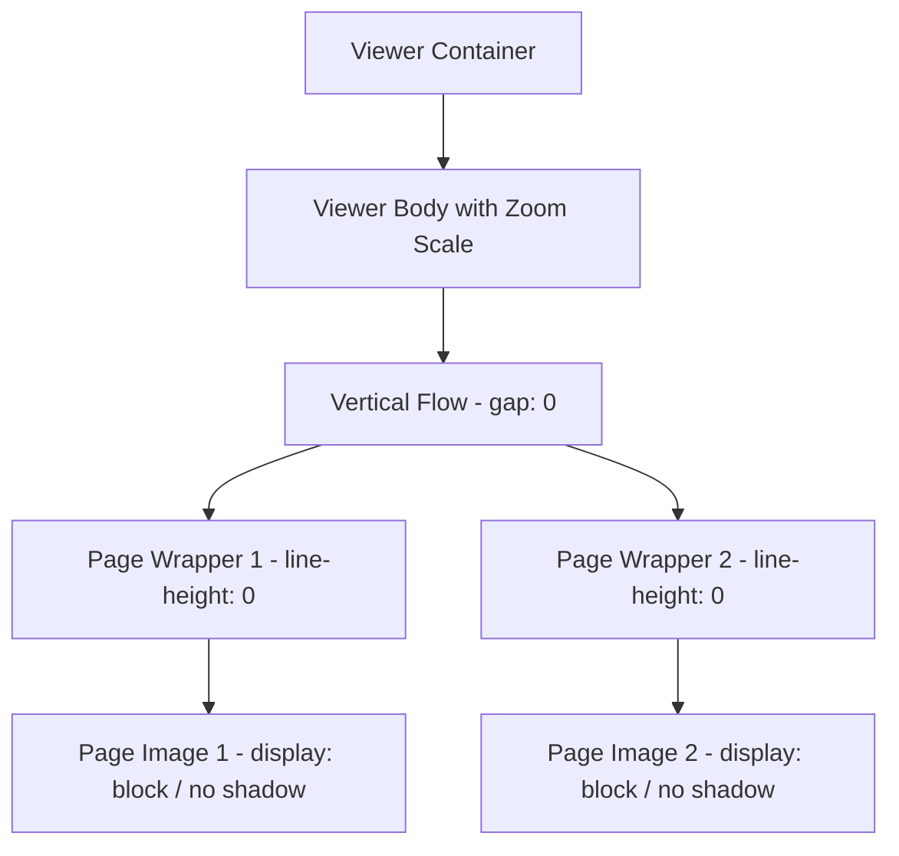

# Requirements

### Overview & Goals
When reading manga, webtoons, or comics in vertical mode, images represent continuous vertical strips that should connect seamlessly. Currently, the reader introduces artificial gaps (1.5rem gap, border radius, and box shadows) between consecutive pages in vertical mode, interrupting narrative flow and visual continuity.

The goal of this change is to eliminate all vertical spacing, flex gaps, image border radii, and drop shadows between images in `VERTICAL` reading mode so readers experience an uninterrupted, smooth vertical strip reading experience.

### Scope
- **In Scope:**
  - Removing flex gap, margins, and paddings between page elements in vertical reading mode.
  - Resetting image `border-radius` and `box-shadow` in vertical mode to prevent visual seam borders.
  - Ensuring `display: block` and zero line-height on image wrappers to prevent HTML inline baseline whitespace gaps.
  - Preserving standard styling and borders for `PAGED` reading mode.
  - Validating zoom behavior and responsive scaling in vertical mode.
- **Out of Scope:**
  - Backend chapter ingestion or image slicing modifications.
  - Altering chapter comment section or viewer toolbar navigation controls.

### User Stories
- As a reader viewing webtoons in vertical mode, I want consecutive page slices to touch without gaps or borders so that I can read seamlessly without immersion breaks.
- As a reader using paged mode, I want individual pages to retain clean single-page presentation with proper card framing.

### Functional Requirements
- When `state.viewMode() === 'VERTICAL'`:
  - Consecutive page images within `.vertical-flow` must have 0px vertical gap between them.
  - Page wrapper containers must not introduce padding or margins between consecutive pages.
  - Page images must not have rounded corners (`border-radius: 0`) or drop shadows (`box-shadow: none`) in vertical mode.
  - Images must render as block-level elements (`display: block`) to eliminate inline baseline spacing.
- When `state.viewMode() === 'PAGED'`:
  - Active page rendering and navigation buttons must remain intact with appropriate single-page framing.
- Zoom functionality (`state.zoomLevel()`) must scale the seamless strip smoothly without introducing gap artifacts.

### Non-Functional Requirements
- **Visual Performance:** Avoid layout thrashing; styling changes must be pure CSS/SCSS with hardware-accelerated transforms on zoom.
- **Cross-Browser Consistency:** Prevent sub-pixel rendering gaps across modern desktop and mobile browsers.

# Technical Design

### Current Implementation
- `frontend/src/app/features/reader/components/chapter-viewer.html`:
  - In `VERTICAL` view mode, iterates through `state.currentChapter()?.pages` inside `
` with child `

`.
- `frontend/src/app/features/reader/components/chapter-viewer.scss`:
  - `.vertical-flow` specifies `gap: 1.5rem;` and `margin: 2rem 0;`.
  - `.page-image` specifies `border-radius: 4px;` and `box-shadow: 0 4px 6px -1px rgba(0, 0, 0, 0.5);`.
  - Missing explicit block display on images and wrappers, which can allow inline whitespace gaps.

### Key Decisions
- **Scope seamless styling to `.vertical-flow`**: Keep single-page styling (box shadow, radius) intact for `.paged-flow` while making `.vertical-flow` images borderless, shadowless, and flush (`gap: 0`).
- **Eliminate baseline whitespace**: Set `.page-wrapper` to `line-height: 0` / `display: block` and `.page-image` to `display: block` to prevent inline image baseline gaps regardless of DOM whitespace.

### Proposed Changes
1. **SCSS Refinement in `chapter-viewer.scss`**:
   - Update `.vertical-flow`:
     - Change `gap: 1.5rem` to `gap: 0`.
     - Set `width: 100%`, `max-width: 900px` (or full reader body width) as appropriate.
   - Add `.vertical-flow .page-wrapper`:
     - `margin: 0; padding: 0; line-height: 0; width: 100%; display: block;`
   - Update `.vertical-flow .page-image`:
     - `display: block; width: 100%; border-radius: 0; box-shadow: none; margin: 0;`
   - Keep `.paged-flow .page-image`:
     - Keep `border-radius: 4px;` and `box-shadow: 0 4px 6px -1px rgba(0, 0, 0, 0.5);` for single-page presentation.

### Components
- `ChapterViewer` (`frontend/src/app/features/reader/components/chapter-viewer.ts` & `chapter-viewer.scss`):
  - Primary component rendering vertical and paged chapter views.

### File Structure
- `frontend/src/app/features/reader/components/chapter-viewer.scss` (Modified)
- `frontend/tests/unit/features/reader/components/chapter-viewer.spec.ts` (Modified / Verified)

### Architecture Diagram

### Risks & Mitigations
- **Sub-pixel image seams during zoom scaling**: Using `display: block`, `line-height: 0`, and `width: 100%` on page wrappers prevents subpixel rounding seams during fractional scaling.

# Testing

### Validation Approach
- Verify vertical reading layout rendering in unit tests and automated browser tests.
- Ensure that in vertical mode, images are contiguous with zero gap, no rounded corners, and no drop shadows.
- Verify that paged mode continues to display solitary pages with standard framing and navigation controls.

### Key Scenarios
- **Vertical Continuous Strip**: Rendering a multi-page chapter in vertical mode results in adjacent images touching seamlessly.
- **Paged Mode Navigation**: Switching between vertical and paged modes preserves expected styling for each mode.
- **Zoom Adjustment**: Zooming in/out (50% to 200%) maintains seamless alignment without unexpected separation gaps.

### Edge Cases
- **Image Load Fallback**: If an image fails and renders the fallback placeholder, ensure layout remains stable.
- **Single-page Chapters**: Chapters with a single page render cleanly in both vertical and paged modes.

### Test Changes
- `frontend/tests/unit/features/reader/components/chapter-viewer.spec.ts`: Add assertions to verify vertical page structure and styling classes.
- Run `npm run test:ci` across the frontend test suite.

# Delivery Steps

### ✓ Step 1: Update vertical reader layout and image styling in ChapterViewer
The vertical reading flow renders pages as a seamless, continuous strip without margins, flex gaps, or baseline spacing.

- In `frontend/src/app/features/reader/components/chapter-viewer.scss`, update `.vertical-flow` to set `gap: 0`.
- Style `.vertical-flow .page-wrapper` to have zero margin, zero padding, and `line-height: 0` or `display: block` to eliminate inline layout artifacts.
- Update `.vertical-flow .page-image` to use `display: block`, `border-radius: 0`, and `box-shadow: none` so webtoon strips connect without seam artifacts.
- Ensure `.paged-flow .page-image` retains appropriate isolated styling and borders/shadows for single-page reading mode.

### ✓ Step 2: Validate reader presentation and update test suite
Unit and end-to-end tests confirm seamless vertical rendering without regressions in paged mode or zoom controls.

- Update unit tests in `frontend/tests/unit/features/reader/components/chapter-viewer.spec.ts` to assert vertical reader rendering and verify seamless structure.
- Validate reader zoom and mode toggling behavior in `frontend/tests/e2e/reader-viewer.spec.ts`.
- Run frontend unit and lint checks to ensure full test suite passes cleanly.